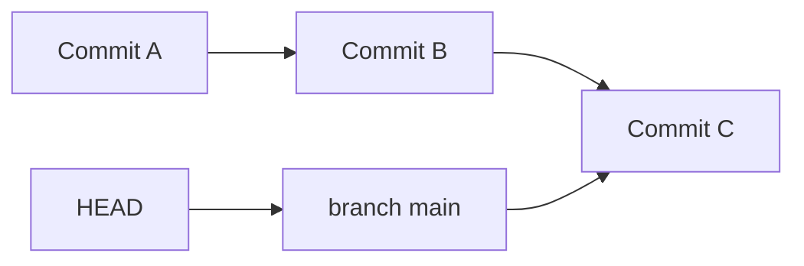
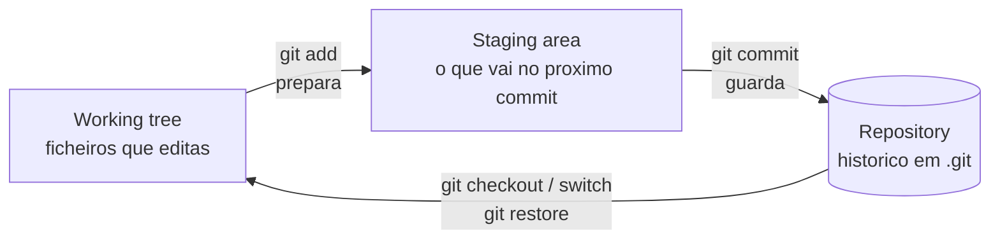
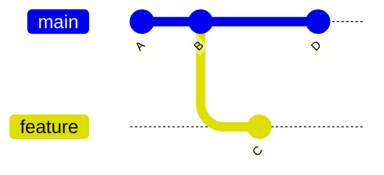

# 01 — O que é Git e GitHub

> **Nível:** Iniciante · **Pré-requisitos:** nenhum · **Tempo estimado:** 45–60 min
> **Objetivo:** distinguir Git de GitHub e definir com precisão repositório, commit, branch, remote, HEAD, staging area e working tree.

## 1. Definição

> **Definição:** **Git** é um sistema de controlo de versões distribuído que guarda snapshots do teu projeto. **GitHub** é uma plataforma web que hospeda repositórios Git e adiciona colaboração (issues, pull requests, actions).

**Finalidade:** o Git resolve o problema de "como voltar atrás, comparar versões e trabalhar em paralelo sem perder nada". O GitHub resolve "como partilhar esse histórico e colaborar com outras pessoas".

## 2. Git vs. GitHub (comparação direta)

| | Git | GitHub |
|---|---|---|
| O quê | Software local de controlo de versões | Plataforma web (servidores + interface) |
| Onde corre | Na tua máquina (`git` no terminal) | No browser / servidores da Microsoft |
| Precisa de internet? | Não (commits locais funcionam offline) | Sim |
| Função | Guardar histórico | Hospedar, colaborar, automatizar |
| Alternativas | Mercurial, SVN (raros hoje) | GitLab, Bitbucket, Codeberg, Forgejo |

> [!TIP]
> Podes usar Git sem GitHub (só localmente ou com outra plataforma). Não podes usar GitHub sem Git por baixo — todo o repositório no GitHub é um repositório Git.

## 3. Conceitos fundamentais (um a um)

### Repositório

> **Definição:** pasta com histórico versionado. A subpasta `.git/` guarda tudo: objetos, referências, logs.

**Analogia:** a pasta do projeto é a casa; o `.git/` é o arquivo da casa onde ficam todas as fotografias antigas.

### Commit

> **Definição:** fotografia (snapshot) do projeto num momento. Cada commit tem hash único, autor, data, mensagem e apontador para o commit pai.

**Antes / depois de um commit:** antes, as alterações vivem só no disco; depois, ficam guardadas permanentemente no histórico e podes voltar a elas a qualquer momento.

### Branch

> **Definição:** apontador móvel para um commit. Permite linhas de desenvolvimento paralelas sem copiar pastas.

Ver lição completa em [[01-branches-switch-checkout|08 — Branches]].

### Remote

> **Definição:** apelido de um repositório noutro local (ex.: `origin` aponta para o URL no GitHub).

Ver lição completa em [[01-repositorios-remotes-tags|10 — Remotes]].

### HEAD

> **Definição:** apontador para onde estás agora — normalmente, o último commit do branch atual.

**Como funciona:** o HEAD segue-te quando mudas de branch ou de commit. Em `main` com 3 commits A → B → C, o HEAD aponta para C (através de `main`).

### Staging area (índice) e working tree

> **Definição:** a **working tree** são os ficheiros que editas no disco; a **staging area** é a seleção do que vai no próximo commit; o **repository** é o histórico permanente em `.git/`.

Leitura seta a seta: editas na working tree; `git add` prepara na staging; `git commit` guarda no repository; `switch`/`restore` repõem ficheiros da história para o disco.

| Zona | O que é | Como inspecionar |
|---|---|---|
| Working tree | Ficheiros no disco | `git status` |
| Staging area | Seleção do próximo commit | `git status`, `git diff --staged` |
| Repository | Histórico (`.git/`) | `git log` |

## 4. Como o Git guarda dados (modelo interno)

**Finalidade:** perceber porque o Git é rápido e porque criar branches é quase gratuito.

- **Não guarda diffs por ficheiro** como sistemas antigos (SVN/CVS). Guarda **snapshots**: cada commit aponta para uma árvore completa.
- Ficheiros idênticos entre commits são reutilizados (mesmo hash → mesmo objeto).
- Tipos de objetos: `blob` (conteúdo de ficheiro), `tree` (diretoria), `commit` (snapshot + metadados), `tag` (marca nomeada).

Leitura: `main` avançou A → B → D; `feature` divergiu de B para C. Cada letra é um snapshot completo, não apenas "o que mudou".

**Regra de memória:** "Git guarda fotografias, não rascunhos de diferenças."

## 5. Prática guiada

1. Cria uma pasta `teste-git`, entra nela e corre `git init -b main`.
2. Cria `nota.txt` com uma linha de texto; corre `git status` e identifica em que zona está o ficheiro (resposta: untracked, na working tree).
3. Corre `git add nota.txt && git status` — o que mudou? (Resposta: foi para a staging area.)
4. Desenha de memória o diagrama working tree → staging → repository e compara com o desta lição.

## 6. Avaliação

**Perguntas de compreensão:**

1. Explica com palavras tuas a diferença entre Git e GitHub. Precisas de internet para fazer `git commit`?
2. O que é o HEAD e para onde aponta depois de `git switch main`?
3. Um branch é uma cópia dos ficheiros? Justifica com o modelo interno (apontador + snapshots).

**Exercício prático:** num repo de teste, cria um ficheiro, prepara-o e faz commit; depois usa `git log --oneline` e `git status` para mostrar em que zona está cada informação.

**Desafio de interpretação:** se `git status` mostra `nothing to commit, working tree clean`, o que isso diz sobre as três zonas? (Resposta: working tree igual ao HEAD, staging vazia, nada por guardar.)

**Resumo visual:**

| Conceito | É... | Vives nele via... |
|---|---|---|
| Working tree | Ficheiros no disco | editor + `git status` |
| Staging area | Seleção do próximo commit | `git add`, `git diff --staged` |
| Repository | Histórico em `.git/` | `git commit`, `git log` |
| Branch | Apontador móvel | `git branch`, `git switch` |
| HEAD | "Onde estou" | segue o branch atual |
| Remote | Apelido do repo no GitHub | `git remote -v` |

**Checklist de domínio:**

- [ ] Explicas a diferença Git vs. GitHub sem hesitar.
- [ ] Defines os 7 termos (repositório, commit, branch, remote, HEAD, staging area, working tree).
- [ ] Desenhas de memória o diagrama working tree → staging → repository.
- [ ] Explicas porque um branch é barato (apontador, não cópia).

**Próximo:** [[02-Ciclo-de-vida-dos-ficheiros|02 — Ciclo de vida dos ficheiros]] · **Relacionadas:** [[01-init-clone-status-add-commit|05 — Comandos essenciais]]
