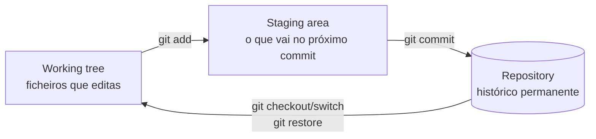
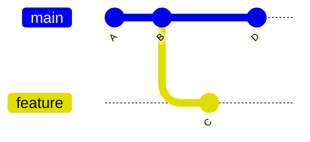

# 01 — O que é Git e GitHub

> **Nível:** 🟢 Iniciante · **Objetivos:** distinguir Git de GitHub; definir repositório, commit, branch, remote, HEAD, staging area e working tree.

## 1. Git vs. GitHub

| | Git | GitHub |
|---|---|---|
| O quê | Sistema de controlo de versões **distribuído** (software local) | Plataforma web para hospedar repositórios Git + colaboração |
| Onde corre | Na tua máquina (`git` na linha de comandos) | Nos servidores da Microsoft / no browser |
| Precisa de internet? | Não (commits locais funcionam offline) | Sim |
| Alternativas | — | GitLab, Bitbucket, Codeberg, Forgejo (auto-hospedado) |

> [!TIP]
> Podes usar Git sem GitHub (ex.: só localmente ou com outra forge). Não podes usar GitHub sem Git por baixo.

## 2. Conceitos fundamentais

### Repositório
Pasta com histórico versionado (a subpasta `.git/` guarda tudo: objetos, refs, logs).

### Commit
Fotografia (snapshot) do projeto num momento. Cada commit tem:
- hash SHA-1/SHA-256 único (ex.: `a3f1c9d...`),
- autor + data,
- mensagem,
- apontador para o commit pai.

### Branch
Apontador móvel para um commit. Permite linhas de desenvolvimento paralelas. Ver [[01-branches-switch-checkout|Branches]].

### Remote
Apelido de um repositório noutro local (ex.: `origin` → URL no GitHub). Ver [[01-repositorios-remotes-tags|Remotes]].

### HEAD
Apontador para onde estás agora (normalmente, o último commit do branch atual).

### Staging area (índice) e working tree

| Zona | O que é | Comando de inspeção |
|---|---|---|
| Working tree | Ficheiros no disco | `git status` |
| Staging area | Seleção do próximo commit | `git status`, `git diff --staged` |
| Repository | Histórico (`.git/`) | `git log` |

## 3. Como o Git guarda dados (modelo interno)

- **Não guarda diffs por ficheiro** como sistemas antigos (SVN/CVS). Guarda **snapshots**: cada commit aponta para uma árvore completa.
- Ficheiros idênticos entre commits são reutilizados (mesmo hash → mesmo objeto).
- Tipos de objetos: `blob` (conteúdo), `tree` (diretoria), `commit`, `tag`.

## 4. Exercício rápido

1. Cria uma pasta `teste-git`, entra nela, corre `git init -b main`.
2. Cria `nota.txt`, corre `git status` e observa em que zona está o ficheiro.
3. Corre `git add nota.txt && git status` — o que mudou?

## Critérios de conclusão
- [ ] Explicas a diferença Git vs. GitHub sem hesitar.
- [ ] Defines os 7 termos do glossário básico ([[01-glossario|Glossário]]).
- [ ] Desenhas de memória o diagrama working tree → staging → repository.

**Próximo:** [[02-Ciclo-de-vida-dos-ficheiros|Ciclo de vida dos ficheiros]] · **Relacionadas:** [[01-init-clone-status-add-commit|Comandos essenciais]]
