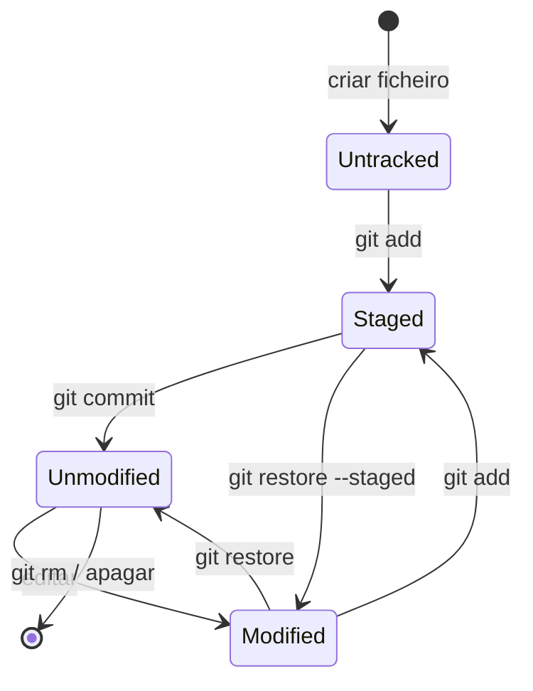
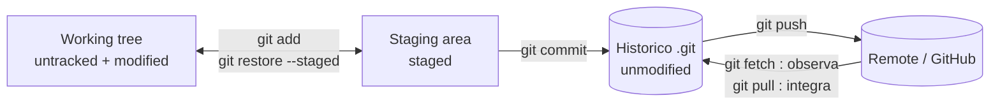
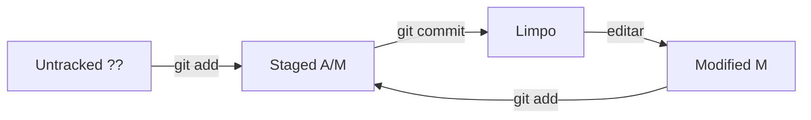

# 02 — Ciclo de vida dos ficheiros

> **Nível:** Iniciante · **Pré-requisito:** [[01-O-que-e-Git-e-GitHub|01 — O que é Git e GitHub]] · **Tempo estimado:** 45 min
> **Objetivo:** identificar o estado de qualquer ficheiro e movê-lo entre estados com o comando certo.

## 1. Definição e finalidade

> **Definição:** o ciclo de vida descreve os 4 estados possíveis de um ficheiro seguido pelo Git: **untracked**, **unmodified**, **modified** e **staged**.

**Finalidade:** saber sempre "onde está" cada ficheiro evita os dois erros clássicos de iniciantes: fazer commit sem `add` ("nothing to commit") e fazer `add .` cego que inclui ficheiros indesejados.

## 2. Os 4 estados

| Estado | Significado | Como verificar (`git status --short`) |
|---|---|---|
| Untracked | Git ainda não segue o ficheiro | `?? ficheiro` |
| Unmodified | Igual ao último commit (limpo) | Não aparece (working tree limpa) |
| Modified | Alterado no disco, fora do staging | ` M ficheiro` (M na 2.ª coluna) |
| Staged | Marcado para o próximo commit | `A  ficheiro` (novo) ou `M  ficheiro` (alterado, 1.ª coluna) |

**Regra de memória:** "?? = pergunta (quem és tu?), M à direita = modificado no disco, M/A à esquerda = pronto na mala."

## 3. Representação visual



Leitura transição a transição:

- Criar ficheiro → **untracked** (o Git vê mas não segue).
- `git add` → **staged** (entra na seleção do próximo commit).
- `git commit` → **unmodified** (guardado; disco igual ao histórico).
- Editar → **modified** (disco diverge do histórico).
- `git restore --staged` desfaz o staging sem tocar no disco; `git restore` descarta edições do disco ([ATENCAO] — perde trabalho).

E a visão por zonas:



## 4. Demonstração linha por linha

```bash
mkdir ciclo-vida && cd ciclo-vida   # pasta de teste isolada
git init -b main                     # repo vazio
echo "ola" > app.txt                 # cria ficheiro -> untracked
git status --short                   # mostra "?? app.txt"
git add app.txt                      # untracked -> staged
git status --short                   # mostra "A  app.txt"
git commit -m "feat: adiciona app.txt"  # staged -> unmodified
git status --short                   # vazio = limpo
echo "linha 2" >> app.txt            # edita -> modified
git status --short                   # mostra " M app.txt"
git diff                             # mostra a alteração ainda NÃO preparada
git add app.txt && git commit -m "feat: expande app.txt"  # volta a unmodified
```

**Antes / depois de cada comando:**

| Comando | Estado antes | Estado depois |
|---|---|---|
| `git add app.txt` (novo) | `??` untracked | `A` staged |
| `git commit` | `A` staged | limpo (unmodified) |
| editar ficheiro | limpo | ` M` modified |
| `git diff` | — | mostra diff working tree vs. staging (não muda estados) |

> [!NOTE]
> Os prefixos `??`, `A`, `M` e linhas vazias acima são exemplos simulados representativos, não saída copiada de uma execução real.

## 5. A distinção que mais confunde: `diff` vs. `diff --staged`

| Comando | Compara | Responde a |
|---|---|---|
| `git diff` | working tree vs. staging | "O que editei e ainda NÃO preparei?" |
| `git diff --staged` | staging vs. último commit | "O que VAI no próximo commit?" |
| `git diff HEAD` | disco + staging vs. último commit | "Tudo o que mudou desde o commit?" |

## 6. Erros frequentes

| Sintoma | Causa | Solução |
|---|---|---|
| `nothing to commit` após editar | Esqueceste `git add` | `git add <ficheiro>` antes do commit |
| Commit sem diff aparente | Ficheiro está no `.gitignore` | Verifica com `git check-ignore -v <ficheiro>` |
| `git add .` incluiu ficheiros indesejados | `add .` adiciona tudo | Usa `git add <caminho>` seletivo ou `git restore --staged` para remover |

> [!WARNING]
> `git add .` na raiz pode preparar segredos (`.env`). Prefere adds seletivos. Ver [[03-gitignore-stash-restore|07 — .gitignore e stash]].

## 7. Prática guiada

1. Prevê o `git status --short` **antes** de cada comando do exemplo acima; só depois corre e compara (10 rondas, meta: 8 acertos).
2. Propositadamente: edita um ficheiro, tenta `git commit -m "x"` sem `add` e lê o erro. Corrige com `add` + `commit`.
3. Pratica `git restore --staged app.txt` e observa o ficheiro voltar de staged a modified sem perder o conteúdo.

## 8. Avaliação

**Perguntas de compreensão:**

1. Um ficheiro acabado de criar está em que estado? E que comando o tira desse estado?
2. Qual a diferença entre `git diff` e `git diff --staged`? Quando cada um mostra vazio?
3. O que faz `git restore --staged` e em que difere de `git restore` simples?

**Exercício prático:** cria dois ficheiros, prepara só um, edita o outro depois do `add`; demonstra com `status --short`, `diff` e `diff --staged` onde está cada alteração.

**Desafio de interpretação:** prevê a saída de `git status --short` após esta sequência (depois confirma): novo ficheiro + `add` + edição sem novo `add`. (Resposta: `AM ficheiro` — staged com alterações posteriores no disco.)

**Resumo visual:**



**Checklist de domínio:**

- [ ] Identificas o estado de qualquer ficheiro com `git status --short`.
- [ ] Explicas a diferença entre `git diff` e `git diff --staged` com um exemplo.
- [ ] Moves ficheiros entre estados sem consultar a lição.

**Próximo:** [[01-Instalacao-e-configuracao-inicial|03 — Instalação e configuração]] · **Ver também:** [[01-init-clone-status-add-commit|05 — init/clone/status/add/commit]]
