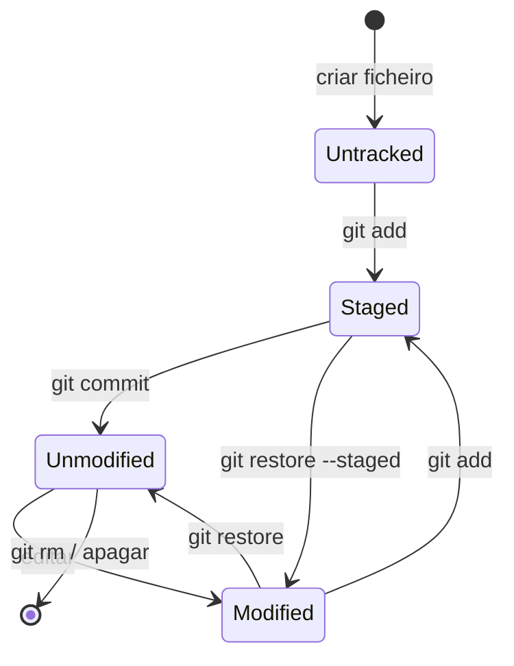

# 02 — Ciclo de vida dos ficheiros

> **Nível:** 🟢 Iniciante · **Pré-requisito:** [[01-O-que-e-Git-e-GitHub|O que é Git e GitHub]]

## 1. Os 4 estados

| Estado | Significado | Como verificar |
|---|---|---|
| Untracked | Git ainda não segue o ficheiro | `git status` → "Untracked files" |
| Unmodified | Igual ao último commit | nada aparece no `git status` |
| Modified | Alterado na working tree, fora do staging | `git status` → "Changes not staged" |
| Staged | Marcado para o próximo commit | `git status` → "Changes to be committed" |

## 2. Diagrama completo



E a visão por zonas:


## 3. Exemplo executável

```bash
mkdir ciclo-vida && cd ciclo-vida
git init -b main
echo "ola" > app.txt
git status --short        # ?? app.txt  → untracked
git add app.txt
git status --short        # A  app.txt  → staged
git commit -m "feat: adiciona app.txt"
git status --short        # (vazio)     → unmodified
echo "linha 2" >> app.txt
git status --short        # " M app.txt" → modified
git diff                  # mostra a alteração não-staged
git add app.txt && git commit -m "feat: expande app.txt"
```

**Resultado esperado:** cada `git status --short` mostra o prefixo indicado no comentário (`??` = untracked, `A` = staged novo, ` M` = modified, vazio = limpo).

## 4. Erros frequentes

| Sintoma | Causa | Solução |
|---|---|---|
| `nothing to commit` após editar | Esqueceste `git add` | `git add <ficheiro>` antes do commit |
| Commit vazio com tudo "staged" mas sem diff | Ficheiro está no `.gitignore` | Verifica com `git check-ignore -v <ficheiro>` |
| `git add .` incluiu ficheiros indesejados | `git add .` adiciona tudo | Usa `git add <caminho>` seletivo ou `git restore --staged` para remover |

> [!WARNING]
> `git add .` na raiz pode stagediar segredos (`.env`). Prefere adds seletivos. Ver [[03-gitignore-stash-restore|.gitignore e stash]].

## Critérios de conclusão
- [ ] Identificas o estado de qualquer ficheiro com `git status --short`.
- [ ] Explicas a diferença entre `git diff` e `git diff --staged`.

**Próximo:** [[01-Instalacao-e-configuracao-inicial|Instalação e configuração]] · **Ver também:** [[01-init-clone-status-add-commit|init/clone/status/add/commit]]
