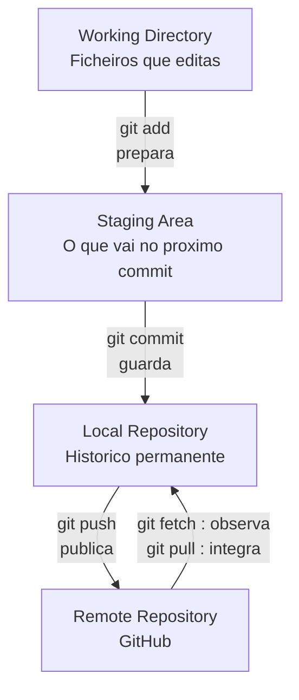
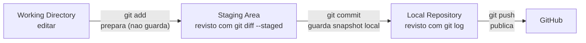

# 05 — init, clone, status, add, commit

> **Nível:** Iniciante · **Pré-requisitos:** [[01-O-que-e-Git-e-GitHub|01 — O que é Git e GitHub]], [[02-Ciclo-de-vida-dos-ficheiros|02 — Ciclo de vida]] · **Tempo estimado:** 60–90 min
> **Objetivo:** criar um repositório, acompanhar o estado dos ficheiros, preparar alterações e guardar snapshots locais com confiança.

## 1. O percurso desta lição



Leitura do diagrama, seta a seta:

- **Working Directory → Staging Area (`git add`):** escolhes o que entra no próximo snapshot. Nada é guardado ainda.
- **Staging Area → Local Repository (`git commit`):** o Git cria um commit permanente no histórico local.
- **Local → Remote (`git push`):** publicas commits locais no GitHub (assunto da lição [[01-repositorios-remotes-tags|10 — Remotes]]).
- **Remote → Local (`fetch` / `pull`):** `fetch` traz informação sem tocar no teu trabalho; `pull` traz e integra (detalhe na lição [[02-fetch-pull-push-remote-avancado|17 — fetch/pull/push avançado]]).

> **Definição:** `init` cria histórico, `clone` copia histórico, `status` mostra o estado, `add` prepara, `commit` guarda.

## 2. Comparação essencial (ler antes dos comandos)

| Comando | Prepara? | Guarda no histórico? | Envia para o GitHub? | Analogia |
|---|---|---|---|---|
| `git add` | Sim | Não | Não | Pôr roupa na mala |
| `git commit` | Não (usa a mala pronta) | Sim, local | Não | Fechar e etiquetar a mala |
| `git push` | Não | Não | Sim | Enviar a mala pelo correio |
| `git fetch` | Não | Não | Não (só observa o remoto) | Ver o tracking da encomenda |
| `git pull` | Não | Cria/atualiza localmente | Não | Receber e arrumar a encomenda |

---

### Comando: `git init`

**Selo:** [SEGURO]
**Definição:** cria um repositório Git novo na pasta atual (ou indicada), gerando a subpasta `.git/` onde vive o histórico.
**Quando utilizar:** para começar um projeto do zero que ainda não está versionado.
**Sintaxe:** `git init [-b <branch-inicial>] [<diretoria>]`
**O que significa cada parte:** `init` = inicializar; `-b main` define o branch inicial como `main` (evita o nome herdado `master`); `<diretoria>` opcional cria e inicializa essa pasta.

**Demonstração linha por linha:**

```bash
mkdir meu-projeto && cd meu-projeto   # cria e entra na pasta do projeto
git init -b main                       # inicializa o repo com branch inicial "main"
git status                             # confirma: branch main, sem commits ainda
```

**Interpretação do resultado (exemplo simulado):**

```text
Initialized empty Git repository in .../meu-projeto/.git/
On branch main
No commits yet
nothing to commit (create/copy files and use "git add" to track)
```

Lê-se assim: o histórico foi criado (vazio), estás no branch `main`, ainda não há commits.

**Antes / depois:**

| | Antes | Depois |
|---|---|---|
| Pasta `.git/` | Não existe | Existe (objetos, refs, config) |
| `git status` | `fatal: not a git repository` | Funciona |
| Histórico | Nenhum | Vazio, pronto para o 1.º commit |

**Erro frequente e correção:** correr `git init` dentro de um repo existente cria um repo aninhado. Correção: verifica primeiro com `git rev-parse --show-toplevel`; se o aninhamento foi acidental, apaga apenas a `.git` interna errada depois de confirmar o caminho.
**Regra de memória:** "init = inaugura; só se usa uma vez por projeto."
**Desafio:** cria uma pasta `teste-init`, inicializa-a e confirma com `git rev-parse --is-inside-work-tree` (esperado: `true`).

---

### Comando: `git clone`

**Selo:** [SEGURO]
**Definição:** copia um repositório remoto completo (histórico, branches, tags) e configura o remote `origin` automaticamente.
**Quando utilizar:** para entrar num projeto que já existe no GitHub em vez de começar do zero.
**Sintaxe:** `git clone <url> [<pasta-destino>]`
**O que significa cada parte:** `clone` = clonar; `<url>` endereço SSH ou HTTPS do repo; `<pasta-destino>` opcional muda o nome da pasta criada.

**Demonstração linha por linha:**

```bash
git clone git@github.com:utilizador/repo.git   # copia o repo e cria a pasta "repo"
cd repo                                         # entra na cópia local
git remote -v                                   # confirma que "origin" aponta para o URL
git log --oneline -3                            # confirma que o histórico veio junto
```

**Antes / depois:**

| | Antes | Depois |
|---|---|---|
| Pasta local | Não existe | Existe com cópia completa + `.git/` |
| Remote `origin` | Nenhum | Configurado automaticamente |
| Histórico | Inacessível | `git log` mostra commits |

**Erro frequente e correção:** `repository not found` significa URL errado ou sem acesso. Correção: confirma o URL e a autenticação na lição [[02-SSH-e-autenticacao|04 — SSH e autenticação]]. Nunca clones dentro de outro repo sem intenção (gera aninhamento).
**Regra de memória:** "Clone = copiar com história; init = começar do zero."
**Desafio:** clona um repo público pequeno via HTTPS e compara `git log --oneline -5` com o histórico visível no GitHub.

---

### Comando: `git status`

**Selo:** [SEGURO]
**Definição:** mostra o estado atual do repositório: branch atual, relação com o remoto e ficheiros por zona. Nunca altera nada.
**Quando utilizar:** antes e depois de qualquer operação. É o comando mais usado do Git.
**Sintaxe:** `git status [--short]`
**O que significa cada parte:** `status` = estado; `--short` dá o formato compacto de duas colunas (`??` novo, `M` modificado, `A` preparado/staged).

**Demonstração linha por linha:**

```bash
echo "ola" > nota.txt   # cria um ficheiro novo (untracked)
git status              # formato longo e explicativo
git status --short      # formato compacto: "?? nota.txt"
```

**Interpretação do resultado (exemplo simulado):**

```text
On branch main
Untracked files:
  (use "git add <file>..." to include in what will be committed)
        nota.txt
nothing added to commit but untracked files present
```

Lê-se assim: estás em `main`; `nota.txt` existe no disco mas o Git ainda não o segue.

**Antes / depois:** `status` não muda nada; muda apenas a tua informação. Usa-o como "espelho" do repo.
**Erro frequente e correção:** nenhum erro grave — o erro é *não* o usar. Hábito: `status` antes de `add`, antes de `commit`, antes de trocar de branch.
**Regra de memória:** "Na dúvida, status."
**Desafio:** cria, edita e prepara um ficheiro e observa as três saídas diferentes de `git status --short` (`??`, `A`, vazio após commit).

---

### Comando: `git add`

**Selo:** [SEGURO]
**Definição:** move alterações da working directory para a staging area, ou seja, escolhe o que entra no próximo commit. Internamente cria objetos `blob` e atualiza o índice.
**Quando utilizar:** sempre que queres selecionar exatamente o conteúdo do próximo snapshot.
**Sintaxe:** `git add <caminho>... | . | -p`
**O que significa cada parte:** `<caminho>` = ficheiro(s) ou pasta; `.` = tudo na pasta atual (usar com cautela); `-p` = modo interativo por pedaços (hunks), ideal para commits limpos.

**Demonstração linha por linha:**

```bash
git add nota.txt    # prepara um ficheiro específico (recomendado)
git status --short  # agora mostra "A  nota.txt" (staged, novo)
git add -p          # modo interativo: y=prepara o pedaço, n=salta, q=sai
```

**Antes / depois:**

| | Antes (`git status --short`) | Depois |
|---|---|---|
| Ficheiro novo | `?? nota.txt` (untracked) | `A  nota.txt` (staged) |
| Ficheiro editado | ` M nota.txt` (modified, fora do staging) | `M  nota.txt` (staged) |
| Histórico | Inalterado | Inalterado (`add` nunca cria commit) |

**Erro frequente e correção:** `git add .` preparou segredos (ex.: `.env`). Correção: `git restore --staged .env` e adiciona a regra ao `.gitignore` (lição [[03-gitignore-stash-restore|07]]). Ficheiro ignorado que não entra: verifica com `git check-ignore -v <ficheiro>`.
**Regra de memória:** "add = adicionar à mala; ainda não fechaste nada."
**Desafio:** edita duas partes de um ficheiro e usa `git add -p` para preparar só uma; confirma com `git diff` (o que falta) vs. `git diff --staged` (o que vai).

---

### Comando: `git commit`

**Selo:** [SEGURO] (local; só afeta o teu histórico até fazeres `push`)
**Definição:** cria um snapshot permanente no branch atual a partir do que está na staging area. Cada commit tem hash único, autor, data, mensagem e apontador para o pai.
**Quando utilizar:** no fim de cada unidade lógica de trabalho, com mensagem clara no formato [[01-conventional-commits-semver-cicd|Conventional Commits]].
**Sintaxe:** `git commit -m "<mensagem>" [--amend]`
**O que significa cada parte:** `-m` = mensagem direta (sem abrir editor); `--amend` = corrige o último commit (só se ainda não fizeste `push`).

**Demonstração linha por linha:**

```bash
git add nota.txt                                          # 1. prepara
git commit -m "feat: adiciona nota de boas-vindas"        # 2. guarda snapshot local
git log --oneline -3                                      # 3. confirma o commit no topo
git status --short                                        # 4. confirma working tree limpa (vazio)
```

**Interpretação do resultado (exemplo simulado):**

```text
[main a1b2c3d] feat: adiciona nota de boas-vindas
 1 file changed, 1 insertion(+)
```

Lê-se assim: criado o commit `a1b2c3d` em `main`, com 1 ficheiro alterado.

**Antes / depois:**

| | Antes | Depois |
|---|---|---|
| Staging | Com alterações preparadas | Vazia (foram guardadas) |
| Histórico (`git log`) | Sem o snapshot | Novo commit no topo |
| Remoto (GitHub) | Inalterado | Inalterado (só `push` envia) |

**Variantes úteis:**

| Comando | Uso |
|---|---|
| `git commit -am "msg"` | `add` + `commit` de ficheiros já seguidos (não inclui ficheiros novos) |
| `git commit --amend` | Corrige mensagem/conteúdo do último commit local |
| `git commit --allow-empty -m "msg"` | Commit vazio, uso raro (ex.: forçar CI) |

**Erros frequentes:**

| Erro | Causa | Correção |
|---|---|---|
| `nothing to commit` | Nada preparado | `git add` primeiro |
| `Author identity unknown` | Falta identidade | Configura `user.name`/`user.email` ([[01-Instalacao-e-configuracao-inicial|03 — Instalação]]) |
| `--amend` depois de `push` | Reescreve histórico partilhado | Prefere um commit novo; ou coordena a equipa |

**Regra de memória:** "commit = fotografia com legenda; push = publicar o álbum."
**Desafio:** faz 3 commits pequenos e lê `git log --oneline --graph -5`: consegues contar a história só pelas mensagens?

---

## 3. Visão por zonas: `add` vs. `commit`



Verificação de cada zona:

| Zona | Pergunta | Comando |
|---|---|---|
| Working directory | O que editei e ainda não preparei? | `git status --short`, `git diff` |
| Staging area | O que vai no próximo commit? | `git diff --staged` |
| Local repository | O que já guardei? | `git log --oneline -5` |

## 4. Prática guiada (fazer por ordem)

1. **Base:** cria pasta `loja`, `git init -b main`, cria `produtos.txt`, observa `git status --short` (`??` = untracked).
2. **Preparar:** `git add produtos.txt`, observa (`A` = staged). Corre `git diff` (vazio — porque já está tudo preparado?) e `git diff --staged` (mostra o conteúdo).
3. **Guardar:** `git commit -m "feat: adiciona lista de produtos"`; `git status --short` fica vazio (limpo).
4. **Repetir com edição:** acrescenta uma linha, prevê o prefixo do `status --short` antes de correr, depois confirma.
5. **Interativo:** edita duas linhas em sítios diferentes e pratica `git add -p` para preparar só uma.

Pistas progressivas: se `git commit` disser `nothing to commit`, volta um passo (faltou `add`). Se pedir identidade, volta à lição 03. Só consulta a solução (os comandos acima) depois de tentares prever o resultado.

## 5. Avaliação

**Perguntas de compreensão:**

1. Qual a diferença entre `git add` e `git commit`? O que cada um altera?
2. `git commit` envia alterações para o GitHub? Porquê?
3. O que esperas ver em `git status --short` para um ficheiro novo, um modificado e um preparado?

**Exercício prático:** num repo de teste, cria dois ficheiros, prepara só um, faz commit e demonstra com `git log --oneline -2` e `git status --short` que o segundo ficou de fora.

**Desafio de interpretação:** antes de correres, prevê a saída de cada linha e depois confirma:

```bash
echo "v1" > versao.txt && git add versao.txt && git commit -m "feat: adiciona versao"
echo "v2" >> versao.txt
git diff --stat
git diff --staged --stat
```

(Resposta esperada: `git diff` mostra a linha nova; `git diff --staged` está vazio, porque a edição ainda não foi preparada.)

**Resumo visual:**

| Preciso de... | Comando |
|---|---|
| Começar do zero | `git init -b main` |
| Copiar projeto existente | `git clone <url>` |
| Ver o estado | `git status --short` |
| Escolher o que guardar | `git add <ficheiro>` / `git add -p` |
| Guardar snapshot local | `git commit -m "tipo: descricao"` |

**Checklist de domínio:**

- [ ] Explicas com palavras tuas o fluxo Working Directory → Staging → Local → Remote.
- [ ] Inicias um repo, fazes 3 commits e lês `git status --short` sem dificuldade.
- [ ] Usaste `git add -p` pelo menos uma vez e distingues `git diff` de `git diff --staged`.
- [ ] Sabes que `commit` é local e que só `push` publica.

**Próximo:** [[02-log-diff-show|06 — log, diff, show]] · **Consolidar:** [[02-Ciclo-de-vida-dos-ficheiros|02 — Ciclo de vida dos ficheiros]]
