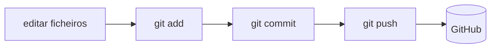

# 05 — init, clone, status, add, commit

> **Nível:** 🟢 Iniciante · **Selo geral:** 🟢 Seguro

## `git init` 🟢

**Sintaxe:** `git init [-b <branch>] [<diretoria>]`
**O que faz:** cria um repositório novo (subpasta `.git/`). Com `-b main` define logo o branch inicial (evita o legado `master`).
**Quando usar:** começar um projeto do zero.

```bash
mkdir meu-projeto && cd meu-projeto
git init -b main
# Resultado: "Initialized empty Git repository in .../meu-projeto/.git/"
```

**Erros:** correr `git init` dentro de outro repo cria repo aninhado (raramente desejado — verifica com `git rev-parse --show-toplevel`). **Alternativa:** `git clone` quando o projeto já existe remotamente.

## `git clone` 🟢

**Sintaxe:** `git clone <url> [<pasta-destino>]`
**O que faz:** copia um repo remoto **com histórico completo** e configura o remote `origin` automaticamente.
**Quando usar:** entrar num projeto existente.

```bash
git clone git@github.com:utilizador/repo.git
cd repo
git remote -v   # confirma o origin
```

**Erros:** `repository not found` → URL errado ou sem acesso (ver [[02-SSH-e-autenticacao|autenticação]]). Clonar dentro de outro repo → aninhamento acidental.

## `git status` 🟢

**Sintaxe:** `git status [--short]`
**O que faz:** mostra branch atual, estado vs. HEAD e ficheiros por zona. **Não altera nada** — usa sem medo.
**Quando usar:** antes e depois de qualquer operação.

```bash
git status
git status --short   # formato compacto: ?? novo, M modificado, A staged
```

## `git add` 🟢

**Sintaxe:** `git add <caminho>... | . | -p`
**O que faz:** move alterações da working tree para a staging area. Internamente cria objetos `blob` e atualiza o índice.
**Quando usar:** selecionar exatamente o que entra no próximo commit.

```bash
git add app.js                 # um ficheiro
git add src/                   # uma pasta
git add -p                     # interativo: escolhe pedaços (hunks) — ideal p/ commits limpos
```

**Erros:** `git add .` stagediou segredos → `git restore --staged .env`. Ficheiro ignorado não entra → verifica `.gitignore` / `git check-ignore -v`.

## `git commit` 🟢 (local)

**Sintaxe:** `git commit -m "<mensagem>" [--amend] [<ficheiro>...]`
**O que faz:** cria um snapshot permanente no branch atual a partir do staging. Só afeta o repo **local** (nada é enviado sem `push`).
**Quando usar:** cada unidade lógica de trabalho, com mensagem clara ([[01-conventional-commits-semver-cicd|Conventional Commits]]).

```bash
git add login.js
git commit -m "feat: adiciona validacao do formulario de login"
git log --oneline -3
# Resultado esperado: o novo commit no topo, ex.: a1b2c3d feat: adiciona validacao...
```

**Variantes úteis:**

| Comando | Uso |
|---|---|
| `git commit -am "msg"` | `add` + `commit` de ficheiros **já tracked** (não inclui ficheiros novos!) |
| `git commit --amend` | Corrige o último commit (mensagem/conteúdo) — 🟡 **só se ainda não fizeste push** |
| `git commit --allow-empty -m "msg"` | Commit vazio (ex.: forçar CI) — uso raro |

**Erros frequentes:**

| Erro | Solução |
|---|---|
| `nothing to commit` | Nada staged → `git add` primeiro |
| `Author identity unknown` | Configura `user.name`/`user.email` ([[01-Instalacao-e-configuracao-inicial|config]]) |
| `--amend` depois do push | Reescreve histórico partilhado → prefere um commit novo ou `push --force-with-lease` com coordenação |



## Critérios de conclusão
- [ ] Inicias um repo, fazes 3 commits e lês `git status --short` sem dificuldade.
- [ ] Usas `git add -p` pelo menos uma vez.

**Próximo:** [[02-log-diff-show|log, diff, show]]
