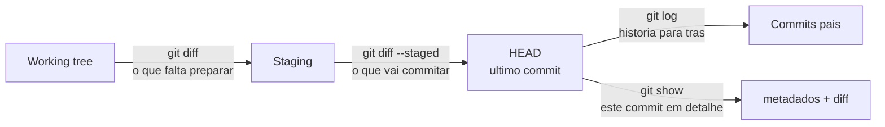

# 06 — log, diff, show

> **Nível:** Iniciante · **Pré-requisito:** [[01-init-clone-status-add-commit|05 — init/clone/status/add/commit]] · **Tempo estimado:** 45 min
> **Objetivo:** ler o histórico, comparar zonas e inspecionar commits para auditar, depurar e preparar reversões com segurança.

## 1. Definição e finalidade

> **Definição:** `log` lista commits, `diff` mostra diferenças entre zonas ou commits, `show` exibe um commit completo (metadados + diff).

**Finalidade:** estes três comandos são os "olhos" do Git — todos [SEGURO], só leem. Usa-os para responder: o que mudou, onde, quando, quem fez e que commit introduziu um bug.



---

### Comando: `git log`

**Selo:** [SEGURO]
**Definição:** lista commits do HEAD para trás, com hash, autor, data e mensagem.
**Quando utilizar:** auditar histórico, encontrar hashes para `revert`/`reset`/`cherry-pick`, entender o que entrou em cada branch.
**Sintaxe:** `git log [--oneline] [--graph --decorate] [-n] [-- <caminho>]`
**O que significa cada parte:** `--oneline` resume cada commit numa linha; `--graph --decorate` desenha branches/tags; `-n` limita (ex.: `-5`); `-- <caminho>` filtra por ficheiro; `-S "texto"` (pickaxe) encontra onde um texto apareceu/desapareceu.

**Demonstração linha por linha:**

```bash
git log --oneline -5
# Exemplo simulado:
# a1b2c3d feat: adiciona validacao do login
# 9f8e7d6 fix: corrige typo no README
# ...

git log --oneline --graph --decorate -10   # mapa com branches e tags
git log -- app.js                          # só commits que tocaram app.js
git log -S "validarEmail"                  # em que commit nasceu/morreu esse texto?
```

**Interpretação:** a primeira coluna é o hash abreviado (apontador para o commit); o resto é a mensagem. `--graph` mostra `*` e bifurcações dos branches.
**Erro frequente e correção:** pager (`less`) prende o terminal no Windows/cmd — sai com `q`, ou evita com `git --no-pager log -5`.
**Regra de memória:** "log = diário de bordo; oneline+graph = mapa."
**Desafio:** encontra com `git log -S` o commit que introduziu uma função no teu repo de teste.

---

### Comando: `git diff`

**Selo:** [SEGURO]
**Definição:** mostra diferenças linha a linha entre duas zonas ou dois commits.
**Quando utilizar:** antes de `add` (rever o que vais preparar), antes de `commit` (rever o que vai entrar) e antes de `push`/PR (rever o que vais publicar).
**Sintaxe:** `git diff [--staged] [<commit> [<commit>]] [-- <caminho>]`

| Comando | Compara | Responde a |
|---|---|---|
| `git diff` | working tree vs. staging | "O que ainda NÃO preparei?" |
| `git diff --staged` | staging vs. último commit | "O que VAI no próximo commit?" |
| `git diff main..feature` | dois commits/branches | "O que diverge entre branches?" |
| `git diff HEAD` | disco + staging vs. último commit | "Tudo o que mudou desde o commit?" |

**Demonstração linha por linha:**

```bash
echo "nova linha" >> app.txt   # edita sem preparar
git diff                       # mostra a linha adicionada (prefixo +)
git add app.txt                # prepara
git diff                       # agora vazio: nada por preparar
git diff --staged              # mostra a linha: é o que vai no commit
```

**Antes / depois:** `diff` nunca muda estados — é espelho. O erro clássico é correr só `git diff` depois do `add` e concluir "não há alterações".
**Erro frequente e correção:** "fiz `add` e o `diff` ficou vazio — perdi o trabalho?" Não: usa `git diff --staged`.
**Regra de memória:** "diff sem argumento vê o disco; --staged vê a mala."
**Desafio:** edita um ficheiro, prepara metade com `add -p`, e mostra que `diff` e `diff --staged` exibem metades complementares.

---

### Comando: `git show`

**Selo:** [SEGURO]
**Definição:** mostra metadados (hash, autor, data, mensagem) + diff de um commit. Sem argumento, mostra o HEAD.
**Quando utilizar:** inspecionar o que um commit realmente fez antes de o reverter, cherry-pickar ou explicar num PR.
**Sintaxe:** `git show [<commit>] [--stat] [-- <caminho>]`
**O que significa cada parte:** `<commit>` hash ou ref (omissão: HEAD); `--stat` resume ficheiros/linhas sem o diff completo.

**Demonstração linha por linha:**

```bash
git show --stat HEAD
# Exemplo simulado:
# commit a1b2c3d... | Author: ... | Date: ...
#  login.js | 20 +++++++++++++++-----
#  1 file changed, 15 insertions(+), 5 deletions(-)

git show 9f8e7d6 -- README.md   # diff daquele commit, só no README
```

**Regra de memória:** "show = abre a fotografia e lê a legenda com lupa."

## 2. Dicas profissionais

- Mapa completo: `git log --oneline --graph --decorate --all -20`.
- Alias útil: `git config --global alias.lg "log --oneline --graph --decorate -15"`.
- No Windows (cmd), aspas e paginação comportam-se diferente; `git --no-pager log -5` evita o pager.

## 3. Prática guiada

1. Corre os quatro `diff` da tabela num repo com edições staged e não-staged e anota o que cada um mostra.
2. Usa `git log --oneline --graph --decorate -10` e identifica merges, branches e tags no desenho.
3. Escolhe um commit e conta a sua história só com `git show --stat` + `git show`.

## 4. Avaliação

**Perguntas de compreensão:**

1. Depois de `git add ficheiro`, porque `git diff` mostra vazio e `git diff --staged` mostra conteúdo?
2. Como encontras o commit que introduziu a string `validarEmail`?
3. O que mostra `git show HEAD` que `git log -1` não mostra?

**Exercício prático:** introduz um bug intencional num repo de teste, commita, e usa `log -S` + `show` para identificar e explicar o commit culpado.

**Desafio de interpretação:** `git diff HEAD --stat` mostra 2 ficheiros mas `git diff --staged --stat` mostra vazio. Onde estão as alterações? (Resposta: só na working tree, nada preparado.)

**Resumo visual:**

| Quero ver... | Comando |
|---|---|
| História resumida com grafo | `git log --oneline --graph --decorate` |
| O que falta preparar | `git diff` |
| O que vai no commit | `git diff --staged` |
| Um commit em detalhe | `git show [--stat] <hash>` |
| Quem mexeu num texto | `git log -S "texto"` |

**Checklist de domínio:**

- [ ] Explicas `git diff` vs. `git diff --staged` com um exemplo.
- [ ] Encontras o commit que introduziu uma linha usando `git log -S`.
- [ ] Lês `git show --stat` e resumis o commit numa frase.

**Próximo:** [[03-gitignore-stash-restore|07 — .gitignore, stash, restore]]
