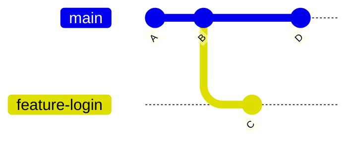
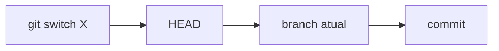

# 08 — Branches: branch, switch, checkout

> **Nível:** Intermédio · **Pré-requisito:** [[01-init-clone-status-add-commit|05 — init/clone/status/add/commit]] · **Tempo estimado:** 60 min
> **Objetivo:** criar, listar e trocar de branches explicando o modelo interno (apontadores + HEAD) e evitando detached HEAD acidental.

## 1. Definição e finalidade

> **Definição:** um branch é um apontador móvel para um commit. Criar um branch custa quase nada (um ficheiro em `.git/refs/heads/`). O `HEAD` aponta para o branch atual.

**Finalidade:** trabalhar em linhas paralelas (features, fixes) sem copiar pastas e sem partir o código estável — cada branch evolui com os seus commits até ser integrado.
**Funcionamento:** quando fazes commit em `feature`, só o apontador `feature` avança; `main` fica parado. `switch` move o HEAD e atualiza working tree + índice.

## 2. Representação visual



Leitura: `main` e `feature-login` partilham A e B; `feature-login` divergiu para C; `main` avançou para D. Criar o branch não copiou nada — só criou um novo apontador em B. HEAD destacado (detached) acontece quando o HEAD aponta direto para um commit (ex.: C) em vez de um branch: commits aí ficam órfãos se não criares branch.



---

### Comando: `git branch`

**Selo:** [SEGURO] (criar/listar); [ATENCAO] com `-D`
**Definição:** lista, cria ou apaga branches. Criar **não troca** para o novo branch.
**Quando utilizar:** ver onde estás, criar base de feature, limpar branches já integrados.
**Sintaxe:** `git branch [<nome>] [<base>] [-d/-D] [-a] [-vv]`
**O que significa cada parte:** sem args lista locais (`*` = atual); `-a` inclui remotos (`origin/...`); `-vv` mostra tracking com o remoto; `-d` apaga só se já merged ([SEGURO]); `-D` força ([ATENCAO] — pode perder commits).

```bash
git branch                        # lista locais (* = atual)
git branch -a                     # inclui remotos
git branch -vv                    # mostra tracking (ahead/behind do remote)
git branch feature-login          # cria a partir do HEAD (NÃO troca)
git branch feature-x main         # cria a partir de main
git branch -d feature-login       # apaga se já merged
git branch -D feature-login       # [ATENCAO] força mesmo sem merge
```

**Antes / depois:** `git branch feature-x` não muda HEAD nem ficheiros — só aparece na lista. Verifica sempre com `git branch --show-current`.
**Regra de memória:** "branch cria o caminho; switch percorre-o."

---

### Comando: `git switch` (moderno, Git ≥ 2.23) vs. `git checkout`

**Selo:** [SEGURO] (com working tree limpa; recusa trocar se houver alterações que seriam sobrescritas)
**Definição:** troca o branch atual, atualizando working tree + índice para o snapshot do destino.
**Quando utilizar:** sempre para trocar/criar branches; reserva `checkout` só para casos sem equivalente em `switch`.
**Sintaxe:** `git switch <branch>` · `git switch -c <novo>` · `git switch -` (volta ao anterior) · `git switch --detach <commit>`

```bash
git switch -c feature-login       # cria E troca (equivale a branch + checkout)
git switch main                   # volta a main
git switch -                      # volta ao branch anterior (atalho útil)
git switch --detach a1b2c3d       # inspeciona commit antigo (HEAD destacado)
git status                        # confirma SEMPRE onde estás depois de trocar
```

| Objetivo | Moderno | Clássico |
|---|---|---|
| Trocar branch | `git switch X` | `git checkout X` |
| Criar + trocar | `git switch -c X` | `git checkout -b X` |
| Repor ficheiro | `git restore [--source=...]` | `git checkout <commit> -- ficheiro` |

> [!NOTE]
> `switch` não extrai ficheiros de outro commit (`checkout <commit> -- <caminho>`); aí usa `git restore --source=<commit> <caminho>` (ver lição [[03-gitignore-stash-restore|07]]).

**Detached HEAD:** commits em detached não pertencem a nenhum branch — ao saíres, "perdem-se" (recuperáveis via `reflog`, lição [[01-reset-revert-reflog|16]]). Se trabalhastes sem querer aí: `git switch -c recuperacao` imediatamente.

**Regra de memória:** "switch = trocar de estrada; -c = abrir estrada nova e entrar nela."

## 3. Erros frequentes

| Erro | Causa | Solução |
|---|---|---|
| `error: Your local changes would be overwritten` | Working tree suja | `stash push`, `commit`, ou resolve antes de trocar |
| `branch already exists` | Nome duplicado | Escolhe outro nome ou apaga com `-d` |
| Trabalhar em detached HEAD e "perder" commits | Commits sem branch são órfãos | Cria branch: `git switch -c recuperacao` |
| Apagaste branch com `-D` | Commits podem existir ainda | `git reflog` → acha o hash → recria ([[01-reset-revert-reflog|16]]) |

## 4. Prática guiada

1. Cria `feature-x` com `git branch` e confirma que o HEAD **não** mudou (`git branch --show-current`).
2. Troca com `switch -c feature-y`, faz um commit, volta a `main` com `switch -` e compara `git log --oneline -3` nos dois.
3. Entra em detached (`switch --detach HEAD~1`), cria um commit de teste e salva-o com `switch -c recuperacao` — depois apaga o branch de teste.

## 5. Avaliação

**Perguntas de compreensão:**

1. Um branch é uma cópia dos ficheiros? O que é criado internamente em `.git/refs/heads/`?
2. Qual a diferença entre `git branch feature-x` e `git switch -c feature-x`?
3. O que é detached HEAD e como sais dele sem perder trabalho?

**Exercício prático:** cria dois branches divergentes com 1 commit cada e desenha o grafo (`git log --oneline --graph --all -6`) explicando onde está o HEAD.

**Desafio de interpretação:** `git status` mostra `HEAD detached at a1b2c3d` e fizeste 2 commits. O que acontece se fizeres `git switch main` agora? Como os recuperas? (Resposta: os commits ficam órfãos mas no reflog; antes de sair, `git switch -c recuperacao`.)

**Resumo visual:**

| Preciso de... | Comando |
|---|---|
| Listar (com remotos + tracking) | `git branch -a -vv` |
| Criar sem trocar | `git branch <nome> [<base>]` |
| Criar + trocar | `git switch -c <nome>` |
| Trocar / voltar | `git switch <x>` / `git switch -` |
| Apagar (merged / forçado) | `git branch -d` / `-D` [ATENCAO] |

**Checklist de domínio:**

- [ ] Crias, listas e trocas de branches só com `branch` + `switch`.
- [ ] Explicas o que é HEAD destacado e como sair dele.
- [ ] Verificas o branch atual antes de commitar.

**Próximo:** [[02-merge-rebase-cherry-pick|09 — merge, rebase, cherry-pick]]
