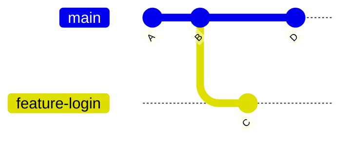

# 08 — Branches: branch, switch, checkout

> **Nível:** 🟡 Intermédio · **Selo:** 🟢 Seguro (criar/trocar não perde dados com working tree limpa)

## 1. O que é um branch (modelo interno)

Um branch é **um apontador móvel para um commit**. Criar um branch custa ~nada (um ficheiro em `.git/refs/heads/`). O `HEAD` aponta para o branch atual.



## 2. `git branch` 🟢

**Sintaxe:** `git branch [<nome>] [-d/-D] [-a] [-vv]`
**O que faz:** lista, cria ou apaga branches. Criar **não troca** para o novo branch.

```bash
git branch                        # lista locais (* = atual)
git branch -a                     # inclui remotos (origin/...)
git branch -vv                    # mostra tracking com o remote
git branch feature-login          # cria a partir do HEAD
git branch feature-x main         # cria a partir de main
git branch -d feature-login       # 🟢 apaga se já merged
git branch -D feature-login       # 🟡 força apagar mesmo sem merge (pode perder commits!)
```

**Resultado esperado:** `git branch` lista `* main` + novos branches sem mudar o HEAD.

## 3. `git switch` 🟢 (moderno, Git ≥ 2.23) vs. `git checkout`

**Sintaxe:** `git switch <branch>` · `git switch -c <novo>` · `git switch -d` não existe — detach: `git switch --detach <commit>`
**O que faz:** troca de branch atualizando working tree + índice. Recusa trocar se houver alterações que seriam sobrescritas (proteção).

```bash
git switch -c feature-login       # cria E troca (equivale a branch + checkout)
git switch main                   # volta a main
git switch -                      # volta ao branch anterior (atalho útil)
git switch --detach a1b2c3d       # inspeciona commit antigo (HEAD destacado)
```

| Objetivo | Moderno | Clássico |
|---|---|---|
| Trocar branch | `git switch X` | `git checkout X` |
| Criar + trocar | `git switch -c X` | `git checkout -b X` |
| Repor ficheiro | `git restore` | `git checkout -- ficheiro` |

**Quando usar `checkout` ainda:** o `switch` não tem equivalente para `git checkout <commit> -- <caminho>` (extrair ficheiro de outro commit) — aí usa `git restore --source=<commit> <caminho>`.

## 4. Erros frequentes

| Erro | Causa | Solução |
|---|---|---|
| `error: Your local changes would be overwritten` | Working tree suja | `stash push`, `commit`, ou `switch -m` com cuidado |
| `branch already exists` | Nome duplicado | Escolhe outro nome ou apaga com `-d` |
| Trabalhar em detached HEAD e "perder" commits | Commits sem branch são órfãos | Cria branch: `git switch -c recuperacao` |
| Apagaste branch com `-D` | Commits podem existir ainda | `git reflog` para achar o hash e recriar ([[01-reset-revert-reflog|reflog]]) |

## Critérios de conclusão
- [ ] Crias, listas e trocas de branches só com `branch` + `switch`.
- [ ] Explicas o que é HEAD destacado e como sair dele.

**Próximo:** [[02-merge-rebase-cherry-pick|merge, rebase, cherry-pick]]
