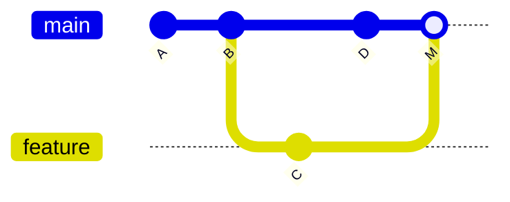
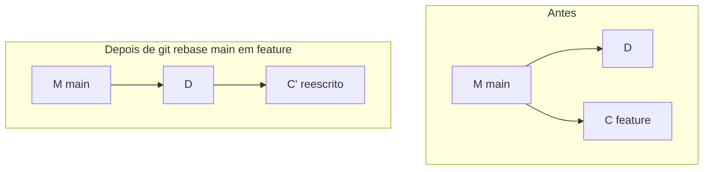

# 09 — merge, rebase, cherry-pick

> **Nível:** 🟡 → 🟠 · **Selos:** `merge` 🟢 · `rebase` 🟡 (reescreve histórico) · `cherry-pick` 🟡

## 1. `git merge` 🟢

**Sintaxe:** `git merge <branch> [--no-ff] [-m "msg"]`
**O que faz:** une dois históricos. Dois modos:

- **Fast-forward:** sem divergência → só avança o apontador, sem commit extra.
- **Merge commit:** com divergência → cria commit de união (2 pais).



```bash
git switch main
git merge feature-login
# Fast-forward ou "Merge made by the 'ort' strategy."

git merge --no-ff feature-login   # força commit de merge (preserva contexto da feature)
git merge --abort                 # 🟢 cancela merge com conflitos, volta ao estado anterior
```

**Quando usar:** integrar features em branches partilhados (`main`, `develop`). É o método **mais seguro** para histórico partilhado.

## 2. `git rebase` 🟡

**Sintaxe:** `git rebase <base> [-i] [--abort|--continue]`
**O que faz:** **re-escreve** os teus commits sobre uma base nova (hashes novos!). Internamente: guarda diffs, reposiciona HEAD, reaplica.
**Quando usar:** atualizar a tua feature privada (`git rebase main` dentro de `feature/*`) para histórico linear. **NUNCA em branches partilhados** (`main`, `develop`) depois de push.



```bash
git switch feature-login
git rebase main                   # traz a feature para cima de main
# ... se houver conflitos: resolve, git add, git rebase --continue
git rebase --abort                # desiste e volta atrás
git rebase -i HEAD~3              # interativo: squash/reword/reorder (só local!)
```

**Riscos:** reescrever commits com push feito exige `push --force-with-lease` e coordenação; colegas com a versão antiga terão divergência. **Alternativa segura:** `git merge main` na feature (cria merge commit, mas não reescreve nada).

### Merge vs. rebase — quando usar

| | merge | rebase |
|---|---|---|
| Histórico | Preserva cronologia real (+ merge commits) | Linear e limpo |
| Segurança | 🟢 Seguro em branches partilhados | 🟡 Só em branches privados |
| Conflitos | Resolve-se de uma vez | Pode repetir-se commit a commit |
| Regra de ouro | Integrar **em** `main`/`develop` | Atualizar **a tua** feature antes do PR |

## 3. `git cherry-pick` 🟡

**Sintaxe:** `git cherry-pick <hash>... [-n] [--abort|--continue]`
**O que faz:** copia commits específicos para o HEAD atual (hash novo, conteúdo igual).
**Quando usar:** trazer um hotfix de `main` para `develop`, ou recuperar um commit de branch apagado.

```bash
git switch develop
git cherry-pick a1b2c3d           # aplica aquele commit aqui
git cherry-pick --abort           # cancela em caso de conflito grave
```

**Riscos:** duplicação de conteúdo (mesmo patch, hashes diferentes) pode gerar conflitos em merges futuros. Prefere `merge` do branch original quando possível.

## 4. Erros frequentes

| Erro | Causa | Solução |
|---|---|---|
| `Automatic merge failed` | Conflito | Ver [[01-conflitos-e-recuperacao|Conflitos]] |
| Rebase com dezenas de conflitos repetidos | Feature muito desatualizada | Aborta; faz `git merge main` em vez disso |
| `failed to push` após rebase | Histórico reescrito | `git push --force-with-lease` (**nunca** `--force` bruto em equipa) |

## Critérios de conclusão
- [ ] Integras uma feature com `merge` e atualizas outra com `rebase`, explicando a diferença.
- [ ] Sabes quando **não** usar rebase.

**Próximo:** [[01-repositorios-remotes-tags|Repositórios, remotes, tags]]
