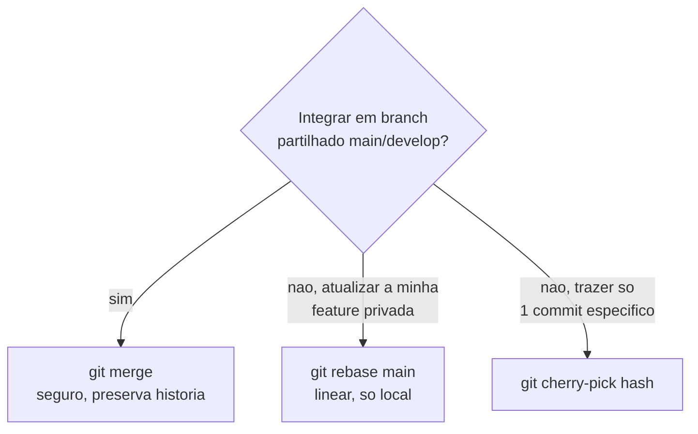
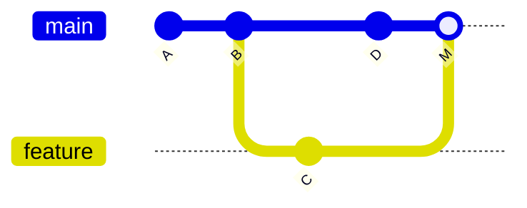
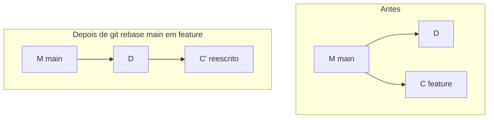

# 09 — merge, rebase, cherry-pick

> **Nível:** Intermédio para Avançado · **Pré-requisito:** [[01-branches-switch-checkout|08 — Branches]] · **Tempo estimado:** 75 min
> **Objetivo:** integrar branches com o método certo (merge seguro, rebase linear, cherry-pick cirúrgico) e saber quando NÃO reescrever histórico.

## 1. A decisão em 30 segundos



**Regra de ouro:** reescreve só o que é só teu. O que já foi partilhado (`push`, PR aberto, `main`/`develop`) integra-se com `merge` ou `revert` — nunca com rebase forçado.

---

### Comando: `git merge`

**Selo:** [SEGURO]
**Definição:** une dois históricos. Sem divergência faz **fast-forward** (só avança o apontador); com divergência cria um **merge commit** (2 pais).
**Quando utilizar:** integrar features em branches partilhados (`main`, `develop`). É o método mais seguro para histórico partilhado.
**Sintaxe:** `git merge <branch> [--no-ff] [-m "msg"]`
**O que significa cada parte:** `<branch>` = o que queres trazer para onde estás; `--no-ff` força merge commit mesmo quando dava fast-forward (preserva contexto da feature); `--abort` cancela com segurança.



```bash
git switch main
git merge feature-login
# Fast-forward ou "Merge made by the 'ort' strategy."

git merge --no-ff feature-login   # força commit de merge (preserva contexto da feature)
git merge --abort                 # cancela merge com conflitos, volta ao estado anterior
```

**Antes / depois (merge com divergência):** antes, `main` em D e `feature` em C; depois, `main` em M (filho de D e C). Nada foi reescrito — a cronologia real fica preservada.
**Regra de memória:** "merge = casamento com certidão (merge commit conta a história)."

---

### Comando: `git rebase`

**Selo:** [ATENCAO] (reescreve hashes; nunca em branches partilhados após push)
**Definição:** descola os teus commits e reaplica-os sobre uma base nova (hashes novos). Internamente: guarda diffs, reposiciona HEAD, reaplica um a um.
**Quando utilizar:** atualizar a tua feature privada (`git rebase main` dentro de `feature/*`) para histórico linear antes do PR. Nunca em `main`/`develop` com push feito.
**Sintaxe:** `git rebase <base> [-i] [--abort|--continue|--skip]`



```bash
git switch feature-login
git rebase main                   # traz a feature para cima de main
# ... se houver conflitos: resolve, git add, git rebase --continue
git rebase --abort                # desiste e volta ao estado anterior
git rebase -i HEAD~3              # interativo: squash/reword/reorder (só local!)
```

**Riscos:** após rebase com push feito, o `push` normal falha — exige `push --force-with-lease` + coordenação; colegas com a versão antiga divergem. **Alternativa segura:** `git merge main` na feature (cria merge commit, mas não reescreve nada).
**Regra de memória:** "rebase = mudar a fundação da casa; só com a casa vazia (só tua)."

### Merge vs. rebase — quando usar

| | merge | rebase |
|---|---|---|
| Histórico | Preserva cronologia real (+ merge commits) | Linear e limpo |
| Segurança | [SEGURO] em partilhados | [ATENCAO] só em privados |
| Conflitos | Resolve-se de uma vez | Pode repetir-se commit a commit |
| Regra | Integrar **em** `main`/`develop` | Atualizar **a tua** feature antes do PR |

---

### Comando: `git cherry-pick`

**Selo:** [ATENCAO] (duplica conteúdo com hash novo)
**Definição:** copia commits específicos para o HEAD atual (conteúdo igual, hash novo).
**Quando utilizar:** trazer um hotfix de `main` para `develop`, ou recuperar um commit de branch apagado. Prefere `merge` do branch original quando possível.
**Sintaxe:** `git cherry-pick <hash>... [-n] [--abort|--continue]`

```bash
git switch develop
git cherry-pick a1b2c3d           # aplica aquele commit aqui
git cherry-pick --abort           # cancela em caso de conflito grave
git cherry-pick --continue        # continua após resolver
```

**Riscos:** duplicação (mesmo patch, hashes diferentes) pode gerar conflitos em merges futuros.
**Regra de memória:** "cherry-pick = escolher cerejas: traz o fruto, não a árvore."

## 2. Erros frequentes

| Erro | Causa | Solução |
|---|---|---|
| `Automatic merge failed` | Conflito | Ver [[01-conflitos-e-recuperacao|13 — Conflitos]] |
| Rebase com dezenas de conflitos repetidos | Feature muito desatualizada | Aborta; faz `git merge main` em vez disso |
| `failed to push` após rebase | Histórico reescrito | `git push --force-with-lease` (nunca `--force` bruto em equipa) |

## 3. Prática guiada

1. Cria divergência real (1 commit em `main`, 1 em `feature`) e integra com `merge`; lê o grafo.
2. Repete noutro repo e integra com `rebase` na feature; compara os grafos e os hashes antes/depois.
3. Pratica `cherry-pick` de um fix de `main` para `develop` e observa o hash novo com `git log --oneline -3` nos dois branches.

## 4. Avaliação

**Perguntas de compreensão:**

1. Quando o `merge` faz fast-forward e quando cria merge commit? Para que serve `--no-ff`?
2. Porque o `rebase` muda os hashes e porque isso é perigoso após `push`?
3. Quando preferes `cherry-pick` a `merge`? Que custo pagas?

**Exercício prático:** atualiza uma feature com `rebase` e integra-a em `main` com `merge --no-ff`, justificando cada escolha em voz alta.

**Desafio de interpretação:** após `git rebase main`, `git push` foi recusado. O que aconteceu e qual o comando seguro para publicar? (Resposta: histórico reescrito divergiu do remoto; `push --force-with-lease` após confirmar que ninguém depende do branch.)

**Resumo visual:**

| Situação | Comando |
|---|---|
| Integrar em partilhado | `git merge <branch>` |
| Atualizar feature privada | `git rebase main` |
| Trazer commit pontual | `git cherry-pick <hash>` |
| Desistir a meio | `merge/rebase/cherry-pick --abort` |

**Checklist de domínio:**

- [ ] Integras uma feature com `merge` e atualizas outra com `rebase`, explicando a diferença.
- [ ] Sabes quando **não** usar rebase.
- [ ] Usas `--abort`/`--continue` sem medo.

**Próximo:** [[01-repositorios-remotes-tags|10 — Repositórios, remotes, tags]]
