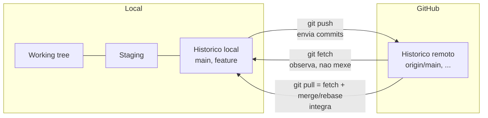

# 10 — Repositórios, remotes, fetch/push/pull, tags

> **Nível:** Intermédio · **Pré-requisitos:** [[01-init-clone-status-add-commit|05]], [[02-SSH-e-autenticacao|04]] · **Tempo estimado:** 75 min
> **Objetivo:** ligar local e remoto, sincronizar com o comando certo e versionar com tags anotadas.

## 1. Definição e finalidade

> **Definição:** um **remote** é um apelido para um repositório noutro local. `origin` é a convenção para o principal; `upstream` para o repo original num fork.

**Finalidade:** o Git é distribuído — cada clone tem histórico completo. Os remotes + `fetch`/`pull`/`push` são a ponte entre a tua cópia e a do GitHub, sem confundir "observar" com "integrar".



---

### Comando: `git remote`

**Selo:** [SEGURO]
**Definição:** gere apelidos para repositórios remotos.
**Quando utilizar:** ligar repo local a GitHub vazio, trabalhar com forks, corrigir URLs.
**Sintaxe:** `git remote [-v] | add <nome> <url> | set-url <nome> <url> | remove <nome>`

```bash
git remote -v
# Exemplo simulado:
# origin  git@github.com:tu/repo.git (fetch)
# origin  git@github.com:tu/repo.git (push)

git remote add upstream git@github.com:original/repo.git  # repo original num fork
git remote set-url origin git@github.com:novo/repo.git    # corrige URL
```

**Regra de memória:** "remote = contactos do telemóvel: nomes curtos para endereços longos."

---

### Comandos: `git fetch` vs. `git pull` vs. `git push`


| Comando | O que faz | Mexe na working tree? |
|---|---|---|
| `git fetch origin` ([SEGURO]) | Atualiza `origin/*` locais, sem tocar nos teus branches | Não |
| `git pull` | `fetch` + integra (`merge` por omissão) no branch atual | Sim |
| `git push` | Envia commits locais para o remote | Não (muda o remoto) |
| `git push -u origin feature-x` | Envia e define **upstream** (depois basta `git push`/`pull`) | — |

**Demonstração linha por linha (o fluxo seguro):**

```bash
git fetch origin                          # 1. observa sem risco
git log --oneline main..origin/main       # 2. o que há de novo no remoto?
git diff main...origin/main               # 3. diff desde a base comum (3 pontos)
git pull --ff-only                        # 4. integra só se for fast-forward (o mais seguro)
git push -u origin feature-login          # 5. publica feature com tracking
git branch -vv                            # 6. confirma tracking (ahead/behind)
```

**Antes / depois:**

| Comando | Antes | Depois |
|---|---|---|
| `fetch` | `origin/main` desatualizado | `origin/main` atualizado; teu `main` intacto |
| `pull --ff-only` (sem divergência) | `main` atrás | `main` = `origin/main` |
| `pull` (com divergência) | históricos divergentes | merge commit ou erro (com `--ff-only` falha em vez de criar merge) |
| `push -u` | branch sem upstream | `push`/`pull` sem argumentos passam a funcionar |

**Erros frequentes:**

| Erro | Causa | Solução |
|---|---|---|
| `failed to push: updates were rejected` | Remote avançou (colega fez push) | `fetch` + integra + resolve; depois `push` |
| `no upstream branch` | Branch local sem tracking | `git push -u origin <branch>` |
| `pull` criou merge commit inesperado | Divergência + `pull.rebase false` | Usa `git pull --ff-only` ou `--rebase` (só em privado) |
| Push para branch protegido recusado | Proteção no GitHub | Abre PR ([[01-pull-requests-e-code-review|12 — PRs]]) |

**Regra de memória:** "fetch = espreitar pela janela; pull = abrir a porta; push = enviar carta registada."

---

### Comando: `git tag`

**Selo:** [SEGURO]
**Definição:** marca nomeada num commit, normalmente para releases. **Anotada** (recomendada) guarda autor, data e mensagem; **leve** é só um apontador.
**Quando utilizar:** versionamento SemVer ([[01-conventional-commits-semver-cicd|18]]) — `vMAJOR.MINOR.PATCH`.
**Sintaxe:** `git tag <v> | -a <v> -m "msg" | -d <v> | --list`

| Tipo | Comando | Uso |
|---|---|---|
| Leve | `git tag v1.0.0` | Marca local temporária |
| Anotada (recomendada) | `git tag -a v1.0.0 -m "Release 1.0.0"` | Release oficial (pode ser assinada com `-s`) |

```bash
git tag -a v1.0.0 -m "Primeira release estavel" main
git push origin v1.0.0        # ATENCAO: tags NAO sobem com push normal!
git push origin --tags        # envia todas
git tag -d v1.0.0 && git push origin :v1.0.0   # apaga local + remoto
```

**Regra de memória:** "tag = etiqueta de versão colada no commit; push normal não leva etiquetas."

## 2. Prática guiada

1. Liga um repo local a um GitHub vazio (`remote add` + `push -u origin main`).
2. Faz `fetch`, lê `main..origin/main`, depois `pull --ff-only` — explica cada saída.
3. Cria e publica uma tag anotada; confirma no GitHub.

## 3. Avaliação

**Perguntas de compreensão:**

1. O que muda no teu trabalho quando corres `git fetch`? E quando corres `git pull`?
2. Para que serve `-u` em `git push -u origin feature-x`? Como confirmas com `branch -vv`?
3. Porque `git push` normal não envia tags? Como as publicas?

**Exercício prático:** simula "remote avançou": faz commit direto no GitHub (ou noutro clone), tenta `push` do primeiro clone, resolve o `updates were rejected` com fetch + integração + push.

**Desafio de interpretação:** `git log --oneline main..origin/main` mostra 3 commits. O que significa? Que comando executas para os trazer sem criar merge inesperado? (Resposta: o remoto tem 3 commits a mais; `git pull --ff-only` se não divergiste, senão integra conscientemente.)

**Resumo visual:**

| Preciso de... | Comando |
|---|---|
| Ver remotes | `git remote -v` |
| Observar sem risco | `git fetch origin` + `git log main..origin/main` |
| Atualizar com segurança | `git pull --ff-only` |
| Publicar com tracking | `git push -u origin <branch>` |
| Versionar | `git tag -a vX.Y.Z -m "msg"` + `git push origin vX.Y.Z` |

**Checklist de domínio:**

- [ ] Explicas `fetch` vs. `pull` e resolves `updates were rejected`.
- [ ] Crias e publicas uma tag anotada.
- [ ] Lês `branch -vv` (tracking, ahead/behind).

**Próximo:** [[02-GitHub-Issues-releases-actions|11 — Issues, releases, Actions]] · **Avançado:** [[02-fetch-pull-push-remote-avancado|17 — fetch/pull/push avançado]]
