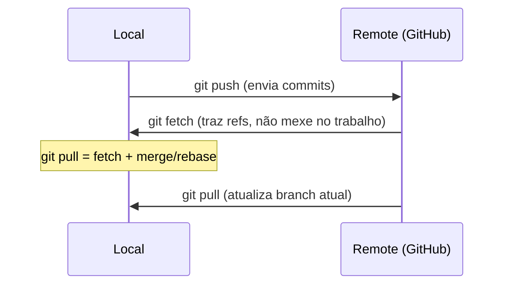

# 10 — Repositórios, remotes, fetch/push/pull, tags

> **Nível:** 🟡 Intermédio · **Selos:** `fetch` 🟢 · `push`/`pull` 🟢 (com nuances) · tags 🟢

## 1. `git remote` 🟢

**Sintaxe:** `git remote [-v] | add <nome> <url> | set-url ... | remove ...`
**O que faz:** gere apelidos para repositórios remotos. `origin` é só a convenção para o principal; `upstream` usa-se para o repo original num fork.

```bash
git remote -v
# origin  git@github.com:tu/repo.git (fetch)
# origin  git@github.com:tu/repo.git (push)

git remote add upstream git@github.com:original/repo.git
git remote set-url origin git@github.com:novo/repo.git
```

## 2. `git fetch` 🟢 vs. `git pull` 🟢 vs. `git push` 🟢



| Comando | O que faz | Mexe na working tree? |
|---|---|---|
| `git fetch origin` | Atualiza `origin/*` locais, sem tocar nos teus branches | Não |
| `git pull` | `fetch` + integra (`merge` por omissão) no branch atual | Sim |
| `git push` | Envia commits locais para o remote | Não (no remote) |
| `git push -u origin feature-x` | Envia e define **upstream** (depois basta `git push`/`pull`) | — |

```bash
git fetch origin
git log --oneline main..origin/main     # o que há de novo no remote?
git pull --rebase                       # alternativa linear (só sem push feito)
git push -u origin feature-login
```

**Erros frequentes:**

| Erro | Causa | Solução |
|---|---|---|
| `failed to push: updates were rejected` | Remote avançou (colega fez push) | `git pull` (ou `fetch` + `merge`) e resolve; depois `push` |
| `no upstream branch` | Branch local sem tracking | `git push -u origin <branch>` |
| `pull` criou merge commit inesperado | Divergência + `pull.rebase false` | Usa `git pull --rebase` ou configura `pull.rebase true` para branches privados |
| Push para branch protegido recusado | Proteção no GitHub | Abre PR em vez de push direto ([[01-pull-requests-e-code-review|PRs]]) |

## 3. `git tag` 🟢

**Sintaxe:** `git tag <v1.2.3> | -a <v> -m "msg" | -d | --list`
**O que faz:** marca um commit (normalmente releases). Dois tipos:

| Tipo | Comando | Uso |
|---|---|---|
| Leve (lightweight) | `git tag v1.0.0` | Marca local temporária |
| Anotada (recomendada) | `git tag -a v1.0.0 -m "Release 1.0.0"` | Release oficial (autor, data, mensagem, pode ser assinada com `-s`) |

```bash
git tag -a v1.0.0 -m "Primeira release estavel" main
git push origin v1.0.0        # ⚠️ tags NÃO sobem com push normal!
git push origin --tags        # envia todas
git tag -d v1.0.0 && git push origin :v1.0.0   # apaga local + remoto
```

**Quando usar:** versionamento semântico ([[01-conventional-commits-semver-cicd|SemVer]]) — `vMAJOR.MINOR.PATCH`.

## Critérios de conclusão
- [ ] Explicas `fetch` vs. `pull` e resolves `updates were rejected`.
- [ ] Crias e publicas uma tag anotada.

**Próximo:** [[02-GitHub-Issues-releases-actions|Issues, releases, Actions]] · **Avançado:** [[02-fetch-pull-push-remote-avancado|fetch/pull/push avançado]]
