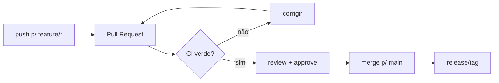

# 11 — GitHub: Issues, releases, Actions, permissões

> **Nível:** 🟡 Intermédio → 🟠 Avançado

## 1. Repositório no GitHub: anatomia

- **Code** (branches, tags, commits), **Issues**, **Pull requests**, **Actions**, **Projects**, **Wiki**, **Settings**.
- Criar repo: `+` → New repository → nome, público/privado, `Add a README` (marca se vais clonar; **não marques** se vais fazer push de repo local existente para evitar divergência inicial).

Ligar repo local a GitHub vazio:

```bash
git remote add origin git@github.com:tu/repo.git
git branch -M main
git push -u origin main
```

## 2. Issues 🟢

- Tarefas, bugs, ideias. Cada issue tem número (`#12`), labels, assignees, milestone.
- **Keywords que fecham issues via commit/PR:** `Closes #12`, `Fixes #12`, `Resolves #12` na mensagem ou descrição do PR.
- Boa issue: título claro, contexto, passos para reproduzir, comportamento esperado vs. atual, ambiente.

## 3. Releases 🟢

- Release = tag anotada + notas + binários. **Draft → Publish**.
- Convenção: tag `v1.2.3` ([[01-conventional-commits-semver-cicd|SemVer]]), notas geradas a partir dos PRs merged (`Generate release notes`).

## 4. GitHub Actions (CI/CD introdutório) 🟡

Corre testes/lints a cada push/PR. Exemplo mínimo (`.github/workflows/ci.yml`):

```yaml
name: CI
on: [push, pull_request]
jobs:
  test:
    runs-on: ubuntu-latest
    steps:
      - uses: actions/checkout@v4
      - uses: actions/setup-node@v4
        with:
          node-version: 20
      - run: npm ci
      - run: npm test
```

> [!NOTE]
> Actions tem minutos gratuitos generosos para repos públicos; para privados há quota mensal — suficiente para aprendizagem. Nada aqui exige plano pago.

## 5. Permissões e proteção de branches 🟡

| Papel | Pode |
|---|---|
| Read | Clonar, abrir issues/PRs |
| Triage / Write | Gerir issues, push em branches não protegidos |
| Maintain / Admin | Gerir settings, proteções, Actions secrets |

**Proteger `main`** (Settings → Branches → Add rule):
- ☑ Require a pull request before merging (ex.: 1 approval)
- ☑ Require status checks to pass (CI verde)
- ☑ Require conversation resolution
- ☐ *Do not* permitir push direto: "Do not allow bypassing the above settings"



## Critérios de conclusão
- [ ] Abres issue, fechas via `Closes #N` num PR e publicas release.
- [ ] Configuras proteção de `main` num repo de teste.

**Próximo:** [[01-pull-requests-e-code-review|Pull Requests e code review]]
