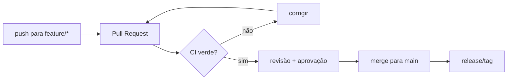

# 11 — GitHub: Issues, releases, Actions, permissões

> **Nível:** Intermédio para Avançado · **Pré-requisito:** [[01-repositorios-remotes-tags|10 — Remotes]] · **Tempo estimado:** 60 min
> **Objetivo:** gerir trabalho (issues), publicar versões (releases), automatizar verificação (actions) e proteger branches.

## 1. Definição e finalidade

> **Definição:** o GitHub soma ao Git quatro camadas: **Issues** (gestão de trabalho), **Pull Requests** (integração com review), **Releases** (versões públicas) e **Actions** (automação CI/CD), com **permissões** por papel.

**Finalidade:** transformar commits isolados em processo de equipa: cada tarefa tem número, cada integração tem verificação, cada versão tem nota, cada branch crítico tem proteção.

## 2. Repositório no GitHub: anatomia

- **Code** (branches, tags, commits), **Issues**, **Pull requests**, **Actions**, **Projects**, **Wiki**, **Settings**.
- Criar repo: `+` → New repository → nome, público/privado. Marca `Add a README` se vais **clonar**; **não marques** se vais fazer push de repo local existente (evita divergência inicial).

Ligar repo local a GitHub vazio:

```bash
git remote add origin git@github.com:tu/repo.git   # 1. regista o contacto
git branch -M main                                  # 2. garante o nome "main"
git push -u origin main                             # 3. publica com tracking
```

## 3. Issues

> **Definição:** tarefa, bug ou ideia numerada (`#12`), com labels, responsáveis e milestone.

- **Keywords que fecham issues via commit/PR:** `Closes #12`, `Fixes #12`, `Resolves #12` na mensagem ou descrição do PR.
- Boa issue: título claro, contexto, passos para reproduzir, comportamento esperado vs. atual, ambiente.

**Exemplo de boa issue (estrutura):**

```text
Título: [bug] login devolve 500 sem email
Contexto: endpoint POST /login em develop, commit a1b2c3d
Reproduzir: 1. POST sem campo email 2. observar 500
Esperado: 400 com mensagem "email obrigatório"
Atual: 500 sem mensagem
Ambiente: backend Node 20, Linux
```

**Regra de memória:** "Sem número de issue, o trabalho é invisível; com `Closes #N`, o PR arruma sozinho."

## 4. Releases

> **Definição:** release = tag anotada + notas + binários. Fluxo: **Draft → Publish**.

- Convenção: tag `v1.2.3` ([[01-conventional-commits-semver-cicd|18 — SemVer]]), notas geradas dos PRs merged (`Generate release notes`).
- Publicar: cria tag (`git tag -a v1.1.0 -m "..."` + push da tag), depois Releases → Draft new release → escolhe a tag → publica.

## 5. GitHub Actions (CI/CD introdutório)

> **Definição:** workflows YAML que correm testes/lint a cada push/PR. [ATENCAO] corre código de terceiros — revê `uses:` antes de copiar.

Exemplo mínimo (`.github/workflows/ci.yml`), explicado bloco a bloco:

```yaml
name: CI
on: [push, pull_request]   # quando corre: cada push e cada PR
jobs:
  test:
    runs-on: ubuntu-latest
    steps:
      - uses: actions/checkout@v4       # 1. obtém o código
      - uses: actions/setup-node@v4     # 2. instala Node...
        with:
          node-version: 20              # ...versão 20
      - run: npm ci                     # 3. instala deps de forma reprodutível
      - run: npm test                   # 4. corre testes (vermelho bloqueia o PR)
```

> [!NOTE]
> Actions tem quota gratuita generosa para repos públicos; para privados há quota mensal — suficiente para aprendizagem. Nada aqui exige plano pago.

## 6. Permissões e proteção de branches

| Papel | Pode |
|---|---|
| Read | Clonar, abrir issues/PRs |
| Triage / Write | Gerir issues, push em branches não protegidos |
| Maintain / Admin | Gerir settings, proteções, Actions secrets |

**Proteger `main`** (Settings → Branches → Add rule):

- Require a pull request before merging (ex.: 1 approval)
- Require status checks to pass (CI verde)
- Require conversation resolution
- Não permitir bypass ("Do not allow bypassing the above settings")



**Regra de memória:** "Branch protegido = porta com duas fechaduras: CI verde + aprovação humana."

## 7. Prática guiada

1. Abre uma issue com a estrutura acima e referencia-a num commit (`... refs #N`).
2. Publica uma release `v0.1.0` com notas geradas.
3. Adiciona o workflow CI mínimo e observa-o correr num PR.

## 8. Avaliação

**Perguntas de compreensão:**

1. Qual a diferença entre tag e release? O que uma release acrescenta?
2. O que acontece quando um PR com `Closes #12` faz merge?
3. Que duas condições deve um branch protegido exigir antes do merge? Porquê?

**Exercício prático:** ciclo completo — issue → branch → PR com CI verde → review → merge → release — documentando cada URL.

**Desafio de interpretação:** o CI está vermelho mas o código "funciona na minha máquina". Podes pedir review? Devem fazer merge? (Resposta: podes pedir opinião, mas não merge em branch protegido; vermelho bloqueia por design — reproduz com `npm ci` + `npm test`.)

**Resumo visual:**

| Preciso de... | Onde / como |
|---|---|
| Registar trabalho | Issues (`#N`, labels, milestone) |
| Fechar issue via PR | `Closes #N` na descrição |
| Publicar versão | tag `vX.Y.Z` + Release com notas |
| Automatizar testes | `.github/workflows/ci.yml` |
| Proteger `main` | PR + CI verde + aprovação |

**Checklist de domínio:**

- [ ] Abres issue, fechas via `Closes #N` num PR e publicas release.
- [ ] Configuras proteção de `main` num repo de teste.
- [ ] Lês um workflow CI e explicas cada passo.

**Próximo:** [[01-pull-requests-e-code-review|12 — Pull Requests e code review]]
