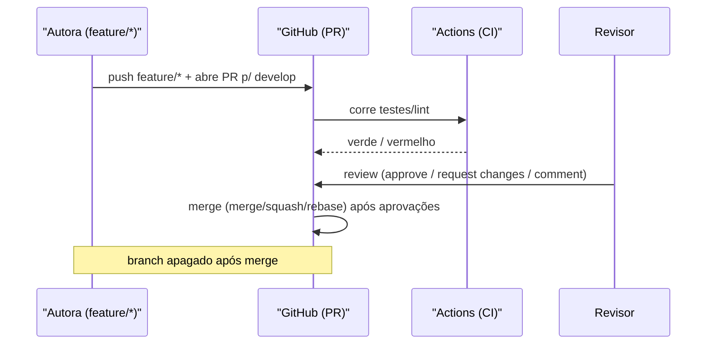
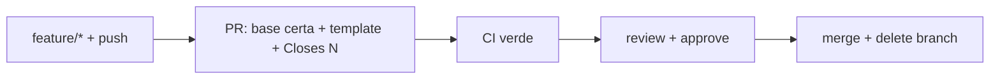

# 12 — Pull Requests e code review

> **Nível:** Intermédio · **Pré-requisitos:** [[01-repositorios-remotes-tags|10]], [[02-GitHub-Issues-releases-actions|11]] · **Tempo estimado:** 75 min
> **Objetivo:** abrir PRs pequenos e revíveis, conduzi-los até ao merge certo e fazer reviews úteis e seguras.

## 1. Definição e finalidade

> **Definição:** um Pull Request é um pedido de integração de um branch noutro, com revisão humana, CI automático e discussão — antes do merge.

**Finalidade:** o PR é o portão de qualidade para `main`/`develop`: impede que código não revisto, não testado ou fora do âmbito entre no código partilhado.



## 2. Ciclo de vida de um PR (passo a passo)

```bash
git switch -c feature/login-validacao
# ... trabalha e commita em unidades pequenas ...
git push -u origin feature/login-validacao
# No GitHub: Compare & pull request → base: develop → título + descrição + Closes #12
```

1. **Abrir:** base correta (`develop`, não `main` — ver [[02-Workflow-Cuidar-Angola|15 — Cuidar Angola]]), título claro, descrição com contexto + testes feitos + `Closes #N`.
2. **CI:** espera o verde; vermelho bloqueia — não peças review com CI quebrado.
3. **Review:** responde a cada comentário; `Resolve conversation` quando tratado.
4. **Atualizar:** se a base avançou → `git fetch` + `git merge origin/develop` na feature (ou `rebase`, só se privado e combinado).
5. **Merge:** escolhe o método abaixo. **Apaga o branch** após o merge (botão Delete branch + `git branch -d` local).

**Template de descrição de PR (copiar e adaptar):**

```text
O quê: valida NIF no formulário de cadastro (Closes #12)
Porquê: registos inválidos chegavam ao backend
Como testar: 1. abrir /cadastro 2. submeter NIF inválido 3. ver erro
Riscos: nenhuma migração; só frontend
```

### Métodos de merge no GitHub

| Método | Resultado | Quando usar |
|---|---|---|
| **Merge commit** | Preserva todos os commits + commit de merge | Histórico fiel (padrão do Git Flow) |
| **Squash and merge** | 1 commit só na base | Features com commits "wip" sujos; mensagem final limpa |
| **Rebase and merge** | Commits reaplicados, linear | Equipas que exigem histórico linear |

**Antes / depois:** antes, a feature vive isolada; depois do merge, a base contém o trabalho + registo (merge commit ou squash), issue fecha sozinha via `Closes #N`, branch é apagado.

## 3. Code review profissional

**Como autora:**

- PR pequeno (idealmente < 400 linhas), focado numa coisa.
- Template preenchido: o quê / porquê / como testar / riscos.

**Como revisora — checklist:**

- [ ] O código faz o que o PR diz? Há testes?
- [ ] Nomes claros? Funções pequenas?
- [ ] Segredos/credenciais expostos? (ver [[02-seguranca-e-boas-praticas|19 — Segurança]])
- [ ] Quebras de compatibilidade / migrações?
- [ ] Comentários: pergunta antes de exigir (`sugestão:` vs. `bloqueador:`).

> [!TIP]
> Review não é caça a typos — o linter faz isso. Foca em lógica, segurança e manutenibilidade.

**Exemplo de comentários úteis:**

```text
bloqueador: este token está hardcoded; move para variável de ambiente.
sugestão: extrair esta validação para função validarNIF() reutilizável?
pergunta: o que acontece se a API devolver 500 aqui?
```

## 4. Erros frequentes

| Erro | Solução |
|---|---|
| PR para a base errada (`main` em vez de `develop`) | Edit → Change base (só sem conflitos graves) |
| PR gigante com 50 commits | Divide em PRs menores; usa squash no fim se permitido |
| `This branch has conflicts` | Atualiza a feature com a base e resolve ([[01-conflitos-e-recuperacao|13 — Conflitos]]) |
| Merge sem aprovação em branch protegido | Impossível por design — pede review |

## 5. Prática guiada

1. Abre um PR completo (descrição com template + issue ligada + CI) num repo de teste.
2. Faz review do PR de um colega (ou do teu, com olhar crítico) com 1 bloqueador e 1 sugestão.
3. Faz merge com o método adequado e apaga o branch local e remoto.

## 6. Avaliação

**Perguntas de compreensão:**

1. Que três elementos tornam um PR "revível" antes mesmo de ler o código?
2. Quando escolhes squash em vez de merge commit? O que se ganha e perde?
3. CI vermelho: pedes review? Fazes merge? Porquê?

**Exercício prático:** conduz um PR real do push ao merge com checklist de revisora preenchida e issue fechada automaticamente.

**Desafio de interpretação:** um PR tem 40 ficheiros, 3 temas e CI vermelho. Lista as 3 primeiras ações da autora por ordem. (Resposta: 1. dividir por tema; 2. corrigir CI; 3. só então pedir review.)

**Resumo visual:**



**Checklist de domínio:**

- [ ] Abres um PR completo (descrição + issue ligada + CI) e fazes merge com o método adequado.
- [ ] Fazes uma review útil com pelo menos 1 bloqueador e 1 sugestão.
- [ ] Apagas branches após merge sem acumular lixo.

**Próximo:** [[01-conflitos-e-recuperacao|13 — Conflitos e recuperação]] · **Workflow real:** [[02-Workflow-Cuidar-Angola|15 — Cuidar Angola]]
