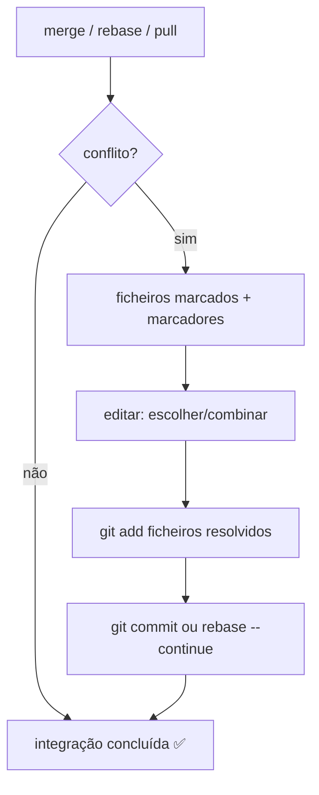

# 13 — Resolução de conflitos e recuperação

> **Nível:** 🟡 Intermédio · **Selo:** 🟢 (resolver) com atenção

## 1. O que é um conflito

Duas alterações **incompatíveis** na mesma zona (mesmas linhas, ou uma apaga o que outra edita). O Git marca o ficheiro e **para** para decidires — nada é perdido automaticamente.



## 2. Anatomia dos marcadores

```text
<<<<<<< HEAD
versão do branch atual (onde estás)
=======
versão do branch que estás a integrar
>>>>>>> feature-login
```

Resolve-se **editando o ficheiro** para o estado final desejado e **removendo os marcadores**.

## 3. Procedimento padrão (merge)

```bash
git merge feature-login
# Auto-merging app.js
# CONFLICT (content): Merge conflict in app.js
# Automatic merge failed; fix conflicts and then commit the result.

git status --short        # "UU app.js" = unmerged, both modified
# 1. Abre app.js, resolve, remove marcadores
# 2. Verifica:
git diff                  # confirma o resultado final
# 3. Marca como resolvido e conclui:
git add app.js
git commit                # mensagem de merge pré-preenchida
```

Para **rebase**, o passo 3 é `git rebase --continue` (ou `--skip` para saltar commit vazio, `--abort` para desistir). Para **cherry-pick**, `git cherry-pick --continue`.

Ferramentas: `git mergetool` (meld, vscode como mergetool), ou o editor de 3 vias do VS Code.

## 4. Tipos de conflito e decisão

| Tipo | Exemplo | Como decidir |
|---|---|---|
| Mesmas linhas editadas | Duas lógicas diferentes | Fala com a outra pessoa; combina se possível |
| Uma apaga, outra edita | `deleted by them/updated by us` | `git add` (manter edição) ou `git rm` (aceitar remoção) |
| Rename vs. edit | Ficheiro movido + editado | Verifica `git status` (rename detection); resolve conteúdo |
| Binários | Imagens, PDFs | Escolhe um lado: `git checkout --ours/--theirs -- ficheiro` |

> [!NOTE]
> `--ours` = branch onde estás; `--theirs` = branch que estás a integrar. Em **rebase os papéis invertem-se** na prática — em dúvida, inspeciona com `git diff` antes de decidir.

## 5. Recuperação de desastres

| Desastre | Recuperação |
|---|---|
| Commit errado (mensagem) | `git commit --amend` (só local, sem push) |
| Commit errado (conteúdo, já com push) | `git revert <hash>` — cria commit inverso, 🟢 seguro (ver [[01-reset-revert-reflog|reset/revert]]) |
| `reset --hard` / branch apagado | `git reflog` → acha o hash → `git reset --hard <hash>` ou recria branch |
| Merge a meio deu para o torto | `git merge --abort` (antes de commitar) |
| Segredos no histórico | **Roda as credenciais primeiro!** Depois: `git rm --cached`, `revert` ou reescrita com `git filter-repo` (reescrita exige coordenação — ver [[02-seguranca-e-boas-praticas|Segurança]]) |
| Problemas de autenticação no push | [[02-SSH-e-autenticacao|SSH e autenticação]] |

## 6. Erros frequentes

| Erro | Solução |
|---|---|
| Commitar com marcadores `<<<<<<<` dentro | `git diff --check` antes do commit deteta; usa hook/CI |
| Resolver sempre "o meu lado" sem ler | Inspeciona `git log --merge -p` para ver ambos os lados |
| Conflito em `package-lock.json` | Regenera: aceita um lado e corre `npm install` de novo |

## Critérios de conclusão
- [ ] Provocas e resolves um conflito de merge num repo de teste.
- [ ] Sabes abortar merge/rebase e recuperar via reflog.

**Próximo:** [[01-git-flow-github-flow-trunk-based|Workflows profissionais]]
