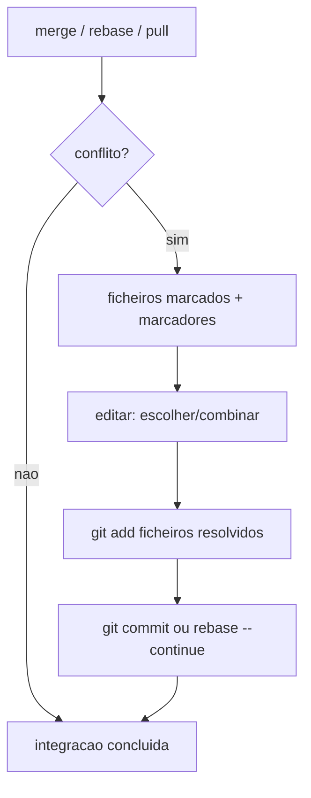

# 13 — Resolução de conflitos e recuperação

> **Nível:** Intermédio · **Pré-requisitos:** [[02-merge-rebase-cherry-pick|09]], [[01-reset-revert-reflog|16 (leitura paralela)]] · **Tempo estimado:** 75 min
> **Objetivo:** resolver conflitos de merge/rebase com método e recuperar dos 5 desastres mais comuns sem pânico.

## 1. Definição e finalidade

> **Definição:** um conflito são duas alterações incompatíveis na mesma zona (mesmas linhas, ou uma apaga o que outra edita). O Git marca o ficheiro e **para** para decidires — nada é perdido automaticamente.

**Finalidade:** impedir que o Git adivinhe e destrua trabalho alheio. O conflito não é erro teu — é o Git a pedir uma decisão humana informada.



## 2. Anatomia dos marcadores

> **Definição:** marcadores são as linhas `<<<<<<<`, `=======`, `>>>>>>>` que o Git insere para mostrar os dois lados.

```text
<<<<<<< HEAD
versão do branch atual (onde estás)
=======
versão do branch que estás a integrar
>>>>>>> feature-login
```

Resolve-se **editando o ficheiro** para o estado final desejado e **removendo os marcadores**. Usa `git log --merge -p` para ver ambos os lados com contexto, e `git diff --check` antes de commitar para apanhar marcadores esquecidos.

## 3. Procedimento padrão (merge), linha por linha

```bash
git merge feature-login
# Exemplo simulado:
# Auto-merging app.js
# CONFLICT (content): Merge conflict in app.js
# Automatic merge failed; fix conflicts and then commit the result.

git status --short        # "UU app.js" = unmerged, ambos modificaram
# 1. Abre app.js, escolhe/combina, remove marcadores
git diff                  # 2. confirma o resultado final pretendido
git add app.js            # 3. marca como resolvido
git commit                # 4. conclui (mensagem de merge pré-preenchida)
git diff --check          # 5. garantia: sem marcadores esquecidos
```

Para **rebase**, o passo 4 é `git rebase --continue` (ou `--skip` para saltar commit vazio, `--abort` para desistir). Para **cherry-pick**, `git cherry-pick --continue`. Para **abortar tudo** antes de concluir: `git merge --abort` / `git rebase --abort`.

Ferramentas: `git mergetool` (meld, VS Code como mergetool) ou o editor de 3 vias do VS Code.

**Antes / depois:**

| Fase | `git status --short` | Significado |
|---|---|---|
| Conflito aberto | `UU app.js` | Por resolver |
| Após `git add` | `M  app.js` | Resolvido, pronto a concluir |
| Após `commit`/`continue` | limpo | Integração concluída |

## 4. Tipos de conflito e decisão

| Tipo | Exemplo | Como decidir |
|---|---|---|
| Mesmas linhas editadas | Duas lógicas diferentes | Fala com a outra pessoa; combina se possível |
| Uma apaga, outra edita | `deleted by them/updated by us` | `git add` (manter edição) ou `git rm` (aceitar remoção) |
| Rename vs. edit | Ficheiro movido + editado | Verifica `git status` (deteção de rename); resolve conteúdo |
| Binários | Imagens, PDFs | Escolhe um lado: `git checkout --ours/--theirs -- ficheiro` (inspeciona antes) |

> [!NOTE]
> `--ours` = branch onde estás; `--theirs` = branch que estás a integrar. Em **rebase os papéis invertem-se** na prática — em dúvida, inspeciona com `git diff` antes de decidir.

## 5. Recuperação de desastres

| Desastre | Recuperação |
|---|---|
| Commit errado (mensagem, sem push) | `git commit --amend` (só local) |
| Commit errado (conteúdo, com push) | `git revert <hash>` — commit inverso, [SEGURO] (ver [[01-reset-revert-reflog|16]]) |
| `reset --hard` / branch apagado | `git reflog` → acha o hash → `git reset --hard <hash>` ou recria branch |
| Merge a meio deu para o torto | `git merge --abort` (antes de commitar) |
| Segredos no histórico | **Roda as credenciais primeiro!** Depois: `git rm --cached`, `revert` ou reescrita com `git filter-repo` (exige coordenação — ver [[02-seguranca-e-boas-praticas|19]]) |
| Problemas de autenticação no push | [[02-SSH-e-autenticacao|04 — SSH e autenticação]] |

**Regra de memória:** "Conflito = semáforo vermelho: pára, olha os dois lados, decide, sinaliza com add."

## 6. Erros frequentes

| Erro | Solução |
|---|---|
| Commitar com marcadores `<<<<<<<` dentro | `git diff --check` antes do commit deteta; usa hook/CI |
| Resolver sempre "o meu lado" sem ler | Inspeciona `git log --merge -p` para ver ambos os lados |
| Conflito em `package-lock.json` | Regenera: aceita um lado e corre `npm install` de novo |

## 7. Prática guiada

1. Provoca um conflito de propósito: dois branches editam a mesma linha → `merge` → resolve com o método acima.
2. Repete com `rebase` e pratica `--continue` / `--abort`.
3. Simula desastre: `reset --hard` "acidental" num repo descartável e recupera via `reflog`.

## 8. Avaliação

**Perguntas de compreensão:**

1. O que significa `UU` em `git status --short`? E que comando muda para `M `?
2. Quando usas `merge --abort`? E quando já não podes (commit feito)?
3. Commiteste segredo: basta apagar o ficheiro no próximo commit? Porquê?

**Exercício prático:** provoca e resolve um conflito de merge num repo de teste com `diff --check` limpo e testes a passar.

**Desafio de interpretação:** durante `rebase` com 5 commits, o mesmo conflito repete-se 3 vezes. Continuas ou abortas? Que alternativa evita isto? (Resposta: aborta e usa `merge` da base — rebase repete conflito commit a commit; ver lição 09.)

**Resumo visual:**

| Fase | Comando |
|---|---|
| Diagnosticar | `git status --short` (`UU`), `git log --merge -p` |
| Resolver | editar + remover marcadores |
| Concluir | `git add` + `commit` / `rebase --continue` |
| Desistir | `merge/rebase --abort` |
| Garantia | `git diff --check` |

**Checklist de domínio:**

- [ ] Provocas e resolves um conflito de merge num repo de teste.
- [ ] Sabes abortar merge/rebase e recuperar via reflog.
- [ ] Nunca commitas marcadores (`diff --check` no hábito).

**Próximo:** [[01-git-flow-github-flow-trunk-based|14 — Workflows profissionais]]
