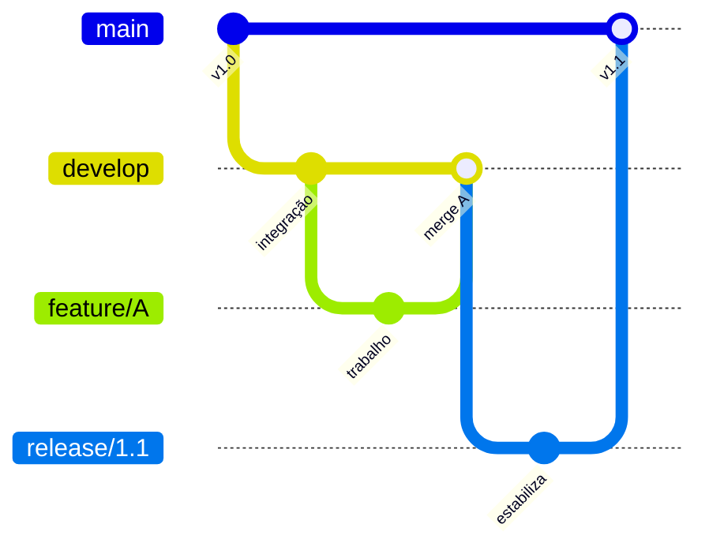
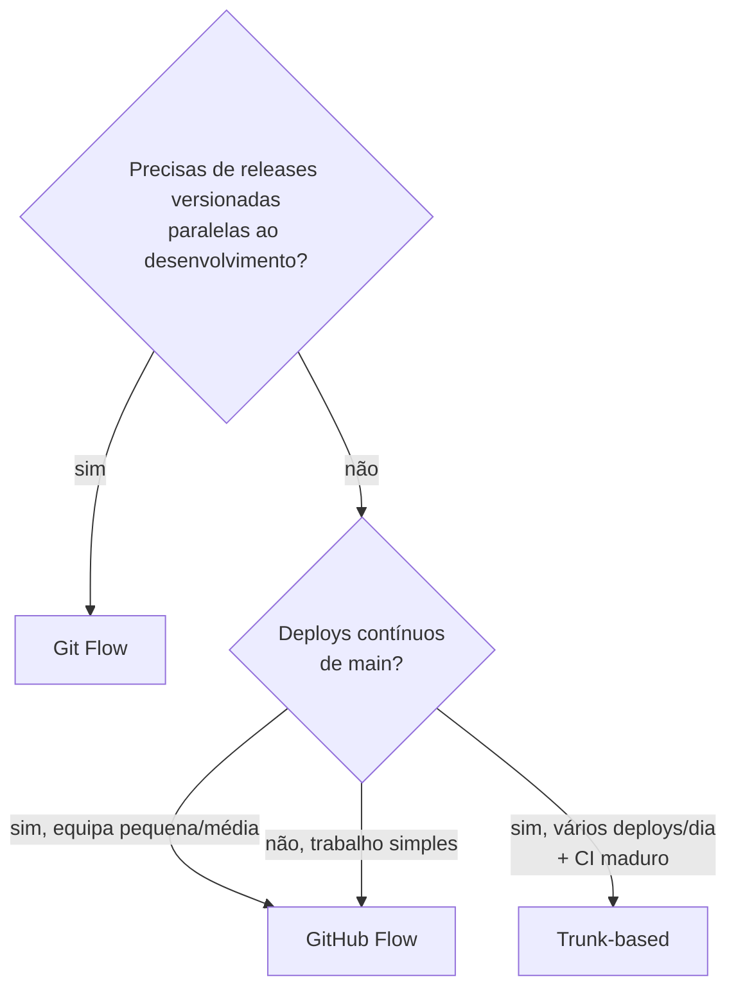

# 14 — Git Flow, GitHub Flow, trunk-based

> **Nível:** 🟠 Avançado · Comparação para escolher com critério.

## 1. Visão geral

| | Git Flow | GitHub Flow | Trunk-based |
|---|---|---|---|
| Branches | `main`, `develop`, `feature/*`, `release/*`, `hotfix/*` | `main` + `feature/*` (PR direto p/ main) | `main` (+ branches curtíssimos < 1-2 dias) |
| Releases | Ciclos planeados via `release/*` | Deploy contínuo de `main` | Deploy contínuo, feature flags |
| Complexidade | Alta (muitos branches) | Baixa | Baixíssima (exige disciplina + CI forte) |
| Ideal para | Software versionado (apps, libs, rigidez de release) | Web apps com deploy frequente, equipas pequenas/médias | Equipas seniores, CI/CD maduro, deploys diários |

## 2. Git Flow (detalhe)

- `main`: só código lançado (tags `v*`).
- `develop`: integração diária.
- `feature/*` ← `develop`, volta para `develop` via PR.
- `release/*`: estabilização (só fixes), depois merge em `main` **e** `develop`.
- `hotfix/*` ← `main`, volta para `main` **e** `develop`.

**Quando usar:** precisas de releases versionadas paralelas à continuação do desenvolvimento (caso do [[02-Workflow-Cuidar-Angola|Cuidar Angola]]).

## 3. GitHub Flow (detalhe)

1. Branch `feature/*` a partir de `main`.
2. Commits + push + PR.
3. Review + CI verde → merge → **deploy imediato de `main`**.

**Quando usar:** produto web com deploy contínuo, sem necessidade de "janelas de release".

## 4. Trunk-based development (detalhe)

- Todos integram em `main` (trunk) pelo menos 1x/dia.
- Features incompletas escondidas com **feature flags**, não com branches longos.
- Exige: CI rápido e fiável, testes bons, pair/mob programming.

**Quando usar:** equipas experientes a fazer deploys múltiplos por dia. **Não recomendado** para equipas a aprender Git (conflitos constantes punem iniciantes).

## 5. Como escolher

> [!TIP]
> Para o projeto Cuidar Angola (frontend + backend, equipa em aprendizagem, produção estável): **Git Flow simplificado** — `main` / `develop` / `feature/*` (+ `hotfix/*`). Detalhe completo em [[02-Workflow-Cuidar-Angola|Workflow Cuidar Angola]].

## Critérios de conclusão
- [ ] Justificas a escolha de workflow para 3 cenários diferentes.
- [ ] Desenhas o Git Flow simplificado de memória.

**Próximo:** [[02-Workflow-Cuidar-Angola|Workflow Cuidar Angola ⭐]]
