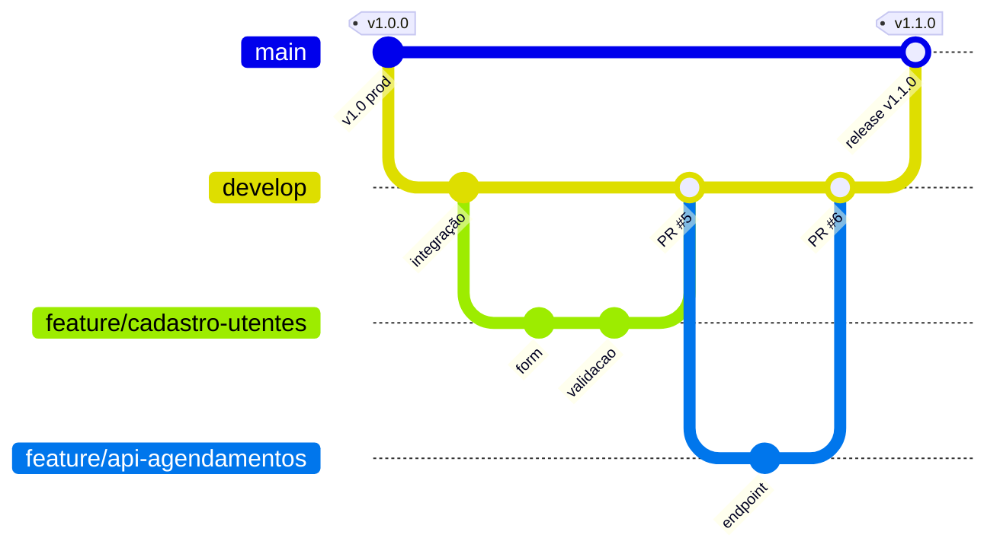
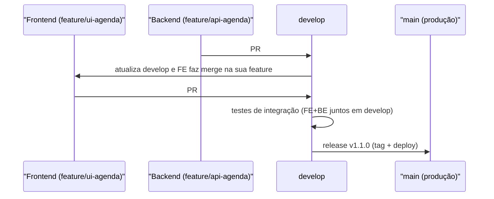
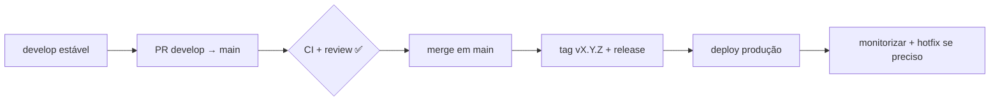

# 15 — Workflow real da equipa: Cuidar Angola ⭐

> **Nível:** 🟡 → 🔴 · **Modelo:** Git Flow simplificado · **Branches:** `main` (produção) · `develop` (integração) · `feature/*` (temporários) · `hotfix/*` (emergências)

## 1. Mapa do fluxo



Colaboração frontend ↔ backend:



## 2. Preparação inicial (uma vez por máquina)

```bash
git clone git@github.com:org/cuidar-angola.git
cd cuidar-angola
git switch develop && git pull
# Convenção: frontend em frontend/, backend em backend/ (monorepo)
# ou dois repos: cuidar-angola-frontend / cuidar-angola-backend
```

Regras de proteção (admin, uma vez): `main` e `develop` **protegidos** — sem push direto, só via PR com 1 aprovação + CI verde (ver [[02-GitHub-Issues-releases-actions|proteção de branches]]).

## 3. Ciclo de uma tarefa (passo a passo)

```bash
# 1. Sincronizar a base
git switch develop && git pull origin develop

# 2. Criar a feature (convenção: feature/<area>-<tarefa>-<issue>)
git switch -c feature/cadastro-utentes-12

# 3. Trabalhar em commits pequenos e convencionais
git add src/components/FormUtente.jsx
git commit -m "feat(frontend): adiciona formulario de cadastro de utentes"
git commit -m "feat(frontend): valida NIF antes de submeter"
# Ref: Closes #12 vai na descrição do PR, não precisa estar no commit

# 4. Manter a feature atualizada (evita o monstro do fim)
git fetch origin
git merge origin/develop
# ... resolve conflitos se houver (ver abaixo) ...

# 5. Publicar e abrir PR: feature/* → develop
git push -u origin feature/cadastro-utentes-12
# No GitHub: PR com base develop, descrição + "Closes #12", pede review

# 6. Após aprovação + CI verde: merge (botão) + apagar branch
git switch develop && git pull origin develop
git branch -d feature/cadastro-utentes-12
git push origin --delete feature/cadastro-utentes-12
```

## 4. Release para produção (`develop` → `main`)

1. `develop` estável (testes manuais + CI verde).
2. PR `develop` → `main` com título `release: v1.1.0`.
3. Merge → tag + release no GitHub:

```bash
git switch main && git pull origin main
git tag -a v1.1.0 -m "Release 1.1.0: cadastro de utentes + API de agendamentos"
git push origin v1.1.0
# Deploy a partir da tag v1.1.0 (pipeline ou manual, conforme o projeto)
```

Fluxo de publicação:



## 5. Hotfix (emergência em produção)

```bash
git switch main && git pull origin main
git switch -c hotfix/login-500
# ... corrige com o mínimo necessário ...
git push -u origin hotfix/login-500
# PR para main (aprovação acelerada) E depois merge/traz para develop:
git switch develop && git pull
git merge origin/main     # ou cherry-pick do fix, se preferires
git push origin develop
```

## 6. Riscos de branches desatualizadas (e como evitá-los)

| Risco | Sintoma | Prevenção |
|---|---|---|
| Feature velha diverge de `develop` | PR com 30 conflitos | `merge origin/develop` na feature **a cada 1-2 dias** |
| Dois devs no mesmo ficheiro sem falar | Conflitos constantes | Dividir por ficheiros/áreas; daily menciona toques partilhados |
| `develop` quebrado bloqueia todos | CI vermelho dias seguidos | Proteger `develop` com CI obrigatório; reverter PR que partiu |
| Push direto em `main` | Produção instável | Proteção de branch (impossível tecnicamente) |
| "Funciona na minha máquina" | Divergência de ambiente | `.nvmrc`/versões fixas, `npm ci`, variáveis de exemplo `.env.example` |

> [!WARNING]
> Regra de ouro da equipa: **nunca commitar direto em `main` ou `develop`**. Tudo entra por PR. Quem precisar de exceção (hotfix), documenta no PR.

## 7. Convenções da equipa (resumo)

| Tema | Convenção |
|---|---|
| Branches | `feature/<area>-<desc>-<issue>`, `hotfix/<desc>`, `release/vX.Y.Z` |
| Commits | [[01-conventional-commits-semver-cicd|Conventional Commits]] em PT ou EN (escolher uma e manter) |
| PRs | Pequenos, 1 tema, template o-quê/porquê/como-testar |
| Issues | Todo o trabalho tem issue; PR fecha com `Closes #N` |
| Releases | SemVer + tag anotada + notas |

## Critérios de conclusão (equipa)
- [ ] Qualquer membro executa o ciclo §3 sem ajuda.
- [ ] `main` e `develop` protegidos; zero pushes diretos há 2 semanas.
- [ ] Release `vX.Y.Z` publicada com notas.

**Relacionadas:** [[01-git-flow-github-flow-trunk-based|Workflows]] · [[01-pull-requests-e-code-review|PRs]] · [[01-conflitos-e-recuperacao|Conflitos]]
