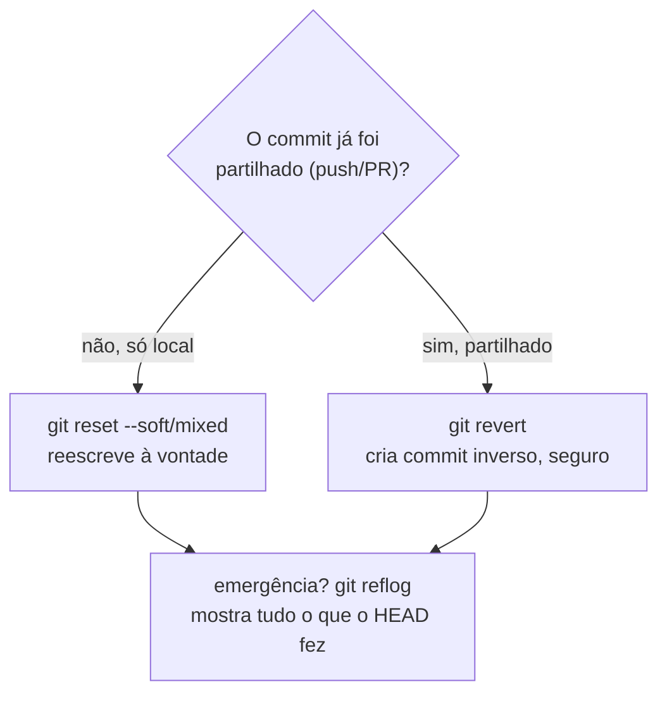
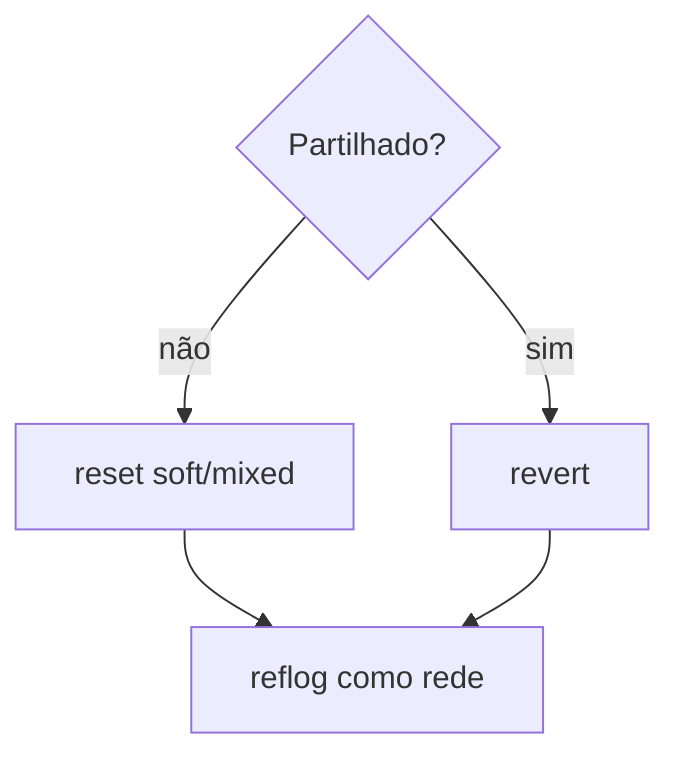

# 16 — reset, revert, reflog

> **Nível:** Avançado · **Pré-requisito:** [[02-merge-rebase-cherry-pick|09]] · **Tempo estimado:** 75 min
> **Objetivo:** desfazer com o comando certo (revert no partilhado, reset no privado) e recuperar qualquer commit "perdido" via reflog.

## 1. A pergunta que decide tudo



> **Definição:** `reset` move o branch para outro commit (reescreve); `revert` cria um commit novo que desfaz outro (soma, não apaga); `reflog` é o diário local de todos os movimentos do HEAD (rede de segurança, ~90 dias).

---

### Comando: `git reset` ([ATENCAO]/[DESTRUTIVO])

**Definição:** move o branch atual para outro commit. Os 3 modos diferem no que acontece ao staging e à working tree.
**Quando utilizar:** só em histórico **ainda não partilhado** (sem push). Com push feito, usa `revert`.
**Sintaxe:** `git reset [--soft|--mixed|--hard] <commit>`

| Modo | HEAD | Staging | Working tree | Uso típico |
|---|---|---|---|---|
| `--soft` [ATENCAO] | move | **mantém** | mantém | Juntar últimos commits (depois `commit` de novo) |
| `--mixed` [ATENCAO] (omissão) | move | **limpa** | mantém | Desfazer `add`, refazer commits |
| `--hard` [DESTRUTIVO] | move | limpa | **APAGA alterações** | Descartar tudo até ao commit (**perde trabalho!**) |

```bash
git log --oneline -4
# Exemplo simulado:
# d4e5f6 (HEAD) wip: tentativa falhada
# a1b2c3 feat: validacao login
git status                  # 1. VERIFICA antes: nada precioso por commitar?
git stash list              # 2. confirma que não há stash esquecido
git reset --soft HEAD~1     # 3a. volta atrás mas mantém tudo staged
git reset HEAD~1            # 3b. mixed: mantém edições no disco, tira do staging
git reset --hard a1b2c3     # 3c. [DESTRUTIVO] apaga tudo após a1b2c3
```

> [!CAUTION]
> `reset --hard` **destrói trabalho não commitado**. Antes: `git status` + `git stash push` se houver dúvida. Nunca `--hard` em branch partilhado com push feito.

**Antes / depois (`--hard a1b2c3`):** antes, HEAD em `d4e5f6` com edições; depois, HEAD em `a1b2c3`, staging vazio, edições apagadas. Recuperação possível via `reflog` (abaixo) — mas conta com isso como airbag, não como plano.
**Regra de memória:** "soft = volta com a mala feita; mixed = esvazia a mala no quarto; hard = deita tudo fora."

---

### Comando: `git revert` ([SEGURO])

**Definição:** cria um **novo commit** que desfaz o efeito de outro. O histórico original fica intacto — por isso é seguro após push.
**Quando utilizar:** desfazer commits já partilhados (push feito, PR merged).
**Sintaxe:** `git revert <hash> [--no-commit]`

```bash
git revert a1b2c3
# Exemplo simulado: [main 9f8e7d6] Revert "feat: validacao login"
git revert --no-commit a1b2c3 b2c3d4   # reverte 2 commits num só commit (revê antes de commitar)
git revert --abort                     # cancela se houver conflito
git log --oneline -3                   # confirma: histórico somou, nada apagou
```

**Regra de memória:** "revert = publicar errata no jornal; reset = rasgar a página (só no teu caderno)."

---

### Comando: `git reflog` ([SEGURO])

**Definição:** diário local de **todos** os movimentos do HEAD (commits, resets, merges, checkouts) — mesmo commits "apagados" ou branches com `-D`.
**Quando utilizar:** "perdi commits", "apaguei branch", "`reset --hard` arrependido".
**Sintaxe:** `git reflog [--date=iso]`

```bash
git reflog
# Exemplo simulado:
# 9f8e7d6 HEAD@{0}: reset: moving to HEAD~1
# d4e5f6 HEAD@{1}: commit: wip: tentativa falhada
git reset --hard d4e5f6    # recupera o commit "perdido"
# ou, sem mover o branch atual: git switch -c recuperacao d4e5f6
```

> [!TIP]
> Apagaste um branch com `-D`? `git reflog` → acha o último hash → `git switch -c <nome> <hash>`.

## 2. Comparação final

| Objetivo | Comando | Selo | Reescreve histórico? |
|---|---|---|---|
| Desfazer `git add` | `git restore --staged` / `reset` mixed no ficheiro | [SEGURO] | Não |
| Refazer último commit local | `commit --amend`, `reset --soft HEAD~1` | [ATENCAO] | Sim (só local) |
| Desfazer commit com push | `git revert` | [SEGURO] | Não (adiciona commit) |
| Achar commits "perdidos" | `git reflog` | [SEGURO] | Não (só lê) |
| Apagar commits/edições | `reset --hard` | [DESTRUTIVO] | Sim + apaga dados |

## 3. Prática guiada (repo descartável!)

1. Cria repo `resgate`, faz 3 commits, `reset --soft HEAD~1` e observa staging cheia.
2. Faz `reset --hard HEAD~1` de propósito e recupera o commit via `reflog`.
3. Simula push (segundo clone como "remoto") e pratica `revert` em vez de `reset`.

## 4. Avaliação

**Perguntas de compreensão:**

1. Commit com push feito introduz bug: `reset --hard` ou `revert`? Porquê?
2. O que distingue `--soft`, `--mixed` e `--hard` quanto a staging e working tree?
3. O `reflog` é partilhado com o GitHub? Até quando guarda entradas?

**Exercício prático:** recupera um commit "perdido" via `reflog` num repo de teste em menos de 5 minutos, explicando cada passo.

**Desafio de interpretação:** `git reflog` mostra `HEAD@{0}: reset: moving to a1b2c3` e `HEAD@{1}: commit: wip importante`. Qual o hash do trabalho a recuperar e que comando o traz de volta sem mover o branch atual? (Resposta: o hash de `HEAD@{1}`; `git switch -c recuperacao <hash>`.)

**Resumo visual:**



**Checklist de domínio:**

- [ ] Explicas quando usar `revert` vs. `reset` sem hesitar.
- [ ] Recuperas um commit "perdido" via `reflog` num repo de teste.
- [ ] Verificas `status` antes de qualquer `reset`.

**Relacionadas:** [[01-conflitos-e-recuperacao|13 — Conflitos e recuperação]] · [[01-erros-comuns-e-solucoes|21 — Erros comuns]]
