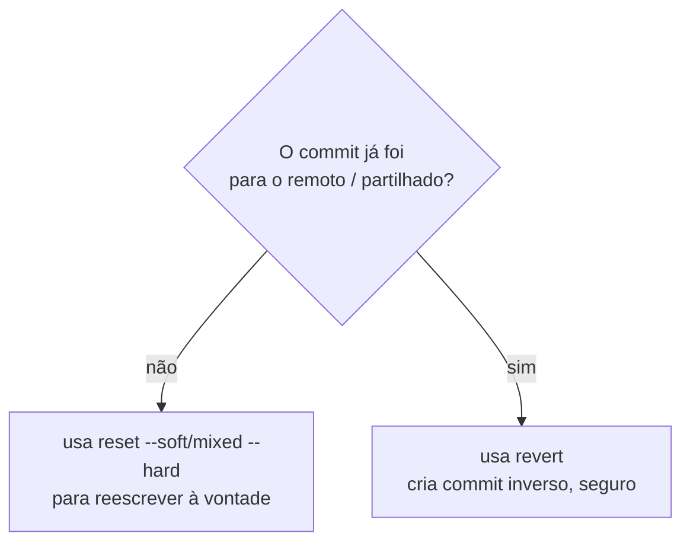

# 16 — reset, revert, reflog

> **Nível:** 🟠 Avançado · **Selos:** `revert` 🟢 · `reset` 🟡/🔴 · `reflog` 🟢

## 1. A pergunta que decide tudo



## 2. `git reset` 🟡/🔴 (reescreve histórico local)

**Sintaxe:** `git reset [--soft|--mixed|--hard] <commit>`
**O que faz:** move o branch atual para outro commit. Os 3 modos diferem no que acontece ao staging e à working tree:

| Modo | HEAD | Staging | Working tree | Uso típico |
|---|---|---|---|---|
| `--soft` 🟡 | move | **mantém** | mantém | Juntar últimos commits (depois `commit` de novo) |
| `--mixed` 🟡 (omissão) | move | **limpa** | mantém | Desfazer `add`, refazer commits |
| `--hard` 🔴 | move | limpa | **APAGA alterações** | Descartar tudo até ao commit (**perde trabalho!**) |

```bash
git log --oneline -4
# d4e5f6 (HEAD) wip: tentativa falhada
# a1b2c3 feat: validacao login
git reset --soft HEAD~1    # volta atrás mas mantém tudo staged
git reset HEAD~1           # mixed: mantém edições, tira do staging
git reset --hard a1b2c3    # 🔴 apaga tudo após a1b2c3 (irreversível sem reflog)
```

> [!CAUTION]
> `reset --hard` **destrói trabalho não commitado**. Antes: `git stash push` ou confirma com `git status`. Nunca `--hard` em branch partilhado com push feito.

## 3. `git revert` 🟢 (seguro, para histórico partilhado)

**Sintaxe:** `git revert <hash> [--no-commit]`
**O que faz:** cria um **novo commit** que desfaz o efeito de outro. O histórico original fica intacto — por isso é seguro após push.

```bash
git revert a1b2c3
# [main 9f8e7d6] Revert "feat: validacao login"
git revert --no-commit a1b2c3 b2c3d4   # reverte 2 commits num só commit
git revert --abort                     # cancela se houver conflito
```

## 4. `git reflog` 🟢 (rede de segurança)

**Sintaxe:** `git reflog [--date=iso]`
**O que faz:** diário local de **todos** os movimentos do HEAD (commits, resets, merges, checkouts) — mesmo commits "apagados" ou branches com `-D`. Válido ~90 dias por omissão.

```bash
git reflog
# 9f8e7d6 HEAD@{0}: reset: moving to HEAD~1
# d4e5f6 HEAD@{1}: commit: wip: tentativa falhada
git reset --hard d4e5f6    # recupera o commit "perdido"
# ou: git switch -c recuperacao d4e5f6
```

> [!TIP]
> Apagaste um branch com `-D`? `git reflog` → acha o último hash → `git switch -c <nome> <hash>`.

## 5. Comparação final

| Objetivo | Comando | Selo | Reescreve histórico? |
|---|---|---|---|
| Desfazer `git add` | `git restore --staged` / `reset` (mixed) | 🟢 | Não |
| Refazer último commit local | `commit --amend`, `reset --soft HEAD~1` | 🟡 | Sim (só local) |
| Desfazer commit com push | `git revert` | 🟢 | Não (adiciona commit) |
| Achar commits "perdidos" | `git reflog` | 🟢 | Não (só lê) |
| Apagar commits/edições | `reset --hard` | 🔴 | Sim + apaga dados |

## Critérios de conclusão
- [ ] Explicas quando usar `revert` vs. `reset` sem hesitar.
- [ ] Recuperas um commit "perdido" via `reflog` num repo de teste.

**Relacionadas:** [[01-conflitos-e-recuperacao|Conflitos e recuperação]] · [[01-erros-comuns-e-solucoes|Erros comuns]]
