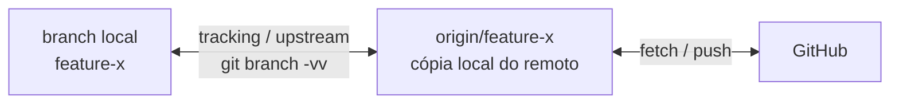

# 17 — fetch, pull, push e remote (avançado)

> **Nível:** Avançado · **Pré-requisito:** [[01-repositorios-remotes-tags|10 — Repositórios e remotes]] · **Tempo estimado:** 60 min
> **Objetivo:** dominar tracking/upstream, refspec, estratégias de pull e push seguro (incluindo forks).

## 1. Definição e finalidade

> **Definição:** tracking liga um branch local ao seu **upstream** (`origin/<branch>`); **refspec** é o mapeamento `origem:destino` que diz o que o `fetch`/`push` transporta.

**Finalidade:** com tracking correto, `git push`/`pull` sem argumentos sabem o que fazer; com `fetch.prune` e `pull --ff-only`, evitas branches-fantasma e merges surpresa.



## 2. Refspec e tracking

```bash
git branch -vv
# Exemplo simulado:
# * feature-x  a1b2c3 [origin/feature-x: ahead 2] feat: ...
# Lê-se: 2 commits locais à frente do remoto (por publicar)

git push -u origin feature-x                      # define upstream (depois basta push/pull)
git branch --set-upstream-to=origin/develop       # redefine tracking existente
```

> **Definição:** `ahead 2` = tens 2 commits por publicar; `behind 3` = o remoto tem 3 que te faltam; `gone` = o branch remoto foi apagado.

## 3. `git fetch` avançado ([SEGURO])

**Quando utilizar:** sempre antes de decidir integrar — observar sem tocar no trabalho.

```bash
git fetch origin                          # tudo
git fetch origin develop                  # só um branch
git fetch --prune origin                  # limpa refs de branches apagados no remoto
git fetch --prune --all
git log --oneline main..origin/main       # o que chegou? (2 pontos: diferença)
git diff main...origin/main               # diff desde a base comum (3 pontos)
```

> [!TIP]
> Configura prune automático: `git config --global fetch.prune true`. Evita lista de branches-fantasma.
> **Regra de memória:** "2 pontos = o que me falta; 3 pontos = o que mudou desde que nos separámos."

## 4. `git pull` avançado ([SEGURO]/[ATENCAO] conforme estratégia)

> **Definição:** `pull` = `fetch` + integração. Controlas a 2.ª fase:

```bash
git pull --ff-only         # só atualiza se for fast-forward; falha se divergiu (o mais seguro p/ main/develop)
git pull --rebase          # linear (ideal em feature privada, sem push feito)
git config --global pull.ff only   # torna ff-only o comportamento padrão
```

| Estratégia | Config | Efeito |
|---|---|---|
| merge (omissão clássica) | `pull.rebase false` | Cria merge commit se divergir |
| rebase | `pull.rebase true` | Reaplica os teus commits por cima |
| só fast-forward | `pull.ff only` | Falha em vez de criar merge — tu decides depois |

**Antes / depois (`--ff-only` com divergência):** nada muda — o comando falha de propósito para integrares conscientemente com `fetch` + `merge`/`rebase`.

## 5. `git push` avançado

```bash
git push origin HEAD:refs/heads/feature-x   # forma explícita src:dst (refspec)
git push --force-with-lease                 # [ATENCAO] reescreve SÓ se ninguém avançou desde o teu fetch
git push --delete origin feature-velha      # apaga branch remoto
git push origin --tags                      # publica tags
```

> [!CAUTION]
> **Nunca `push --force` bruto em branches partilhados** — apaga commits de colegas silenciosamente. `--force-with-lease` aborta se o remote avançou. Em `main`/`develop` protegidos, o force é bloqueado pelo GitHub.
> **Regra de memória:** "force-with-lease = empurrar só se ninguém chegou depois de ti."

## 6. Trabalhar com forks (upstream)

> **Definição:** fork = cópia do repo na tua conta para contribuir via PR sem acesso direto ao original.

```bash
git remote add upstream git@github.com:ORIGINAL/repo.git   # 1. regista o original
git fetch upstream                                          # 2. observa o original
git switch -c minha-feature upstream/main                   # 3. parte do original atualizado
# ... trabalha ...
git push -u origin minha-feature                            # 4. publica no TEU fork → PR para o original
git fetch upstream && git merge upstream/main               # 5. mantém sincronizado
```

**Antes / depois:** antes, o fork desatualiza-se; depois do passo 5, a tua base iguala o original e o PR fica limpo.

## 7. Prática guiada

1. Configura `fetch.prune true` e `pull.ff only` e explica porquê em voz alta.
2. Simula divergência (commit local + commit "remoto" noutro clone) e resolve com `fetch` + decisão consciente.
3. Sincroniza um fork (ou simula com dois remotes) com `upstream` sem ajuda.

## 8. Avaliação

**Perguntas de compreensão:**

1. O que significam `ahead 2` e `behind 1` em `git branch -vv`?
2. Qual a diferença entre `git diff main..origin/main` e `main...origin/main`?
3. Porque `--force-with-lease` é seguro e `--force` não?

**Exercício prático:** configura prune + ff-only, sincroniza um fork com `upstream` e demonstra o tracking com `branch -vv`.

**Desafio de interpretação:** `git pull --ff-only` falhou com "diverged". Descreve os próximos 3 comandos seguros. (Resposta: `git fetch origin` → `git log main..origin/main` para inspecionar → `git merge`/`rebase` consciente.)

**Resumo visual:**

| Preciso de... | Comando |
|---|---|
| Ver tracking | `git branch -vv` |
| Observar + limpar fantasmas | `git fetch --prune origin` |
| Atualizar sem surpresas | `git pull --ff-only` |
| Reescrever com rede | `git push --force-with-lease` (só privado) |
| Seguir o original (fork) | remote `upstream` + `fetch` + `merge` |

**Checklist de domínio:**

- [ ] Configuras `fetch.prune` e `pull.ff only` e explicas porquê.
- [ ] Sincronizas um fork com `upstream` sem ajuda.
- [ ] Nunca usas `--force` bruto em partilhados.

**Relacionadas:** [[01-repositorios-remotes-tags|10 — Remotes (base)]] · [[02-merge-rebase-cherry-pick|09 — merge vs. rebase]]
