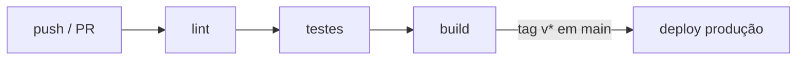

# 18 — Conventional Commits, SemVer, CI/CD

> **Nível:** 🔴 Profissional

## 1. Conventional Commits

Formato: `<tipo>[escopo]: <descrição>` — mensagem curta, imperativa, minúscula (escolhe PT ou EN e mantém).

```text
feat(auth): adiciona login com email e senha
fix(api): corrige status 500 em agendamentos sem utente
docs(readme): atualiza instrucoes de instalacao
refactor(frontend): simplifica validacao do formulario
test(backend): cobre endpoint de agendamentos
chore(ci): atualiza action de setup-node para v4
```

| Tipo | Uso | Sobe versão (SemVer) |
|---|---|---|
| `feat` | Nova funcionalidade | MINOR |
| `fix` | Correção de bug | PATCH |
| `docs`, `style`, `test`, `chore`, `refactor` | Sem mudança de comportamento | — |
| `feat!` / `BREAKING CHANGE:` no rodapé | Quebra compatibilidade | MAJOR |

**Porquê:** gera changelogs automáticos, decide bumps de versão e torna `git log --oneline` legível.

## 2. Versionamento semântico (SemVer)

`MAJOR.MINOR.PATCH` (ex.: `2.3.1`):

- **MAJOR:** quebras incompatíveis.
- **MINOR:** features compatíveis.
- **PATCH:** fixes compatíveis.
- Pré-releases: `1.0.0-rc.1`. Tags no Git: `v1.2.3` (ver [[01-repositorios-remotes-tags|tags]]).

## 3. CI/CD mínimo profissional (GitHub Actions)

Pipeline: **lint → test → build → (deploy)**. Ver exemplo base em [[02-GitHub-Issues-releases-actions|Actions]]. Regras:

- CI corre em **todo push e PR**; branch protegido exige verde.
- Segredos em **Settings → Secrets and variables → Actions** (nunca no código!).
- Deploy de `main` por tag (`v*`) ou após merge, com ambiente de produção aprovado manualmente.



## Critérios de conclusão
- [ ] Todos os teus commits de treino seguem o formato e `git log --oneline` conta uma história clara.
- [ ] Um repo teu tem CI verde obrigatório em PRs.

**Próximo:** [[02-seguranca-e-boas-praticas|Segurança e boas práticas]]
