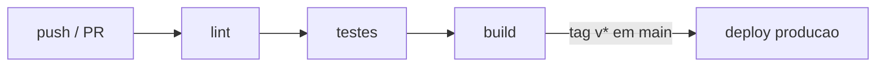

# 18 — Conventional Commits, SemVer, CI/CD

> **Nível:** Profissional · **Pré-requisitos:** [[01-init-clone-status-add-commit|05]], [[02-GitHub-Issues-releases-actions|11]] · **Tempo estimado:** 60 min
> **Objetivo:** escrever histórico legível por humanos e máquinas, versionar sem ambiguidade e gatear tudo com CI.

## 1. Definição e finalidade

> **Definição:** **Conventional Commits** padroniza mensagens (`<tipo>[escopo]: <descrição>`); **SemVer** padroniza versões (`MAJOR.MINOR.PATCH`); **CI/CD** verifica e publica automaticamente.

**Finalidade:** `git log --oneline` conta uma história; changelogs e bumps de versão geram-se sozinhos; CI impede merge de código quebrado. Sem convenção, o histórico é ruído.

## 2. Conventional Commits

Formato: `<tipo>[escopo]: <descrição>` — descrição curta, imperativa, minúscula (escolhe PT ou EN e mantém no repo).

```text
feat(auth): adiciona login com email e senha
fix(api): corrige status 500 em agendamentos sem utente
docs(readme): atualiza instrucoes de instalacao
refactor(frontend): simplifica validacao do formulario
test(backend): cobre endpoint de agendamentos
chore(ci): atualiza action de setup-node para v4
```

| Tipo | Uso | Sobe versão (SemVer) |
|---|---|---|
| `feat` | Nova funcionalidade | MINOR |
| `fix` | Correção de bug | PATCH |
| `docs`, `style`, `test`, `chore`, `refactor` | Sem mudança de comportamento | — |
| `feat!` / `BREAKING CHANGE:` no rodapé | Quebra compatibilidade | MAJOR |

**Exemplo de breaking change (rodapé):**

```text
feat(api)!: remove campo legado "nif_str"

BREAKING CHANGE: clientes devem enviar "nif" numérico; "nif_str" foi removido.
```

**Porque funciona:** cada tipo mapeia para uma decisão de versão e para uma secção do changelog.
**Regra de memória:** "feat = novidade, fix = remendo, ! = parte ossos (major)."

**Erro frequente e correção:** mensagens vagas (`"wip"`, `"fix"`, `"atualiza"`) — sem tipo nem contexto. Correção local (sem push): `git commit --amend -m "feat(escopo): descricao clara"`.

## 3. Versionamento semântico (SemVer)

> **Definição:** `MAJOR.MINOR.PATCH` (ex.: `2.3.1`): **MAJOR** = quebras incompatíveis; **MINOR** = features compatíveis; **PATCH** = fixes compatíveis. Pré-releases: `1.0.0-rc.1`. Tags no Git: `v1.2.3` (ver [[01-repositorios-remotes-tags|10 — tags]]).

**Exemplos de decisão:**

| Mudança | Versão 1.4.2 → |
|---|---|
| Corrige bug sem mudar API | 1.4.3 (patch) |
| Adiciona endpoint opcional | 1.5.0 (minor) |
| Remove campo da API | 2.0.0 (major) |

## 4. CI/CD mínimo profissional (GitHub Actions)

> **Definição:** pipeline **lint → test → build → (deploy)** que corre em cada push/PR; branch protegido exige verde.



Regras:

- CI corre em **todo push e PR**; branch protegido exige verde (ver lição [[02-GitHub-Issues-releases-actions|11]] para o YAML base).
- Segredos em **Settings → Secrets and variables → Actions** (nunca no código!) — detalhe em [[02-seguranca-e-boas-praticas|19 — Segurança]].
- Deploy de `main` por tag (`v*`) ou após merge, com ambiente de produção aprovado manualmente.

**Antes / depois:** antes, merges por confiança; depois, merges só com lint+testes verdes e histórico convencional que gera notas de release.

## 5. Prática guiada

1. Reescreve 5 mensagens vagas tuas para o formato convencional (usa `--amend` só se sem push).
2. Classifica 6 mudanças (fix, feat, breaking, docs, refactor, test) em patch/minor/major/nada.
3. Adiciona CI mínimo a um repo e torna-o obrigatório no branch principal.

## 6. Avaliação

**Perguntas de compreensão:**

1. Que tipo usas para nova funcionalidade compatível? E que versão sobe?
2. Como sinalizas quebra de compatibilidade? O que muda na versão?
3. Onde vivem os segredos do CI e onde nunca devem estar?

**Exercício prático:** histórico de treino com 5 commits convencionais + tag `v1.0.0` + release com notas geradas que fazem sentido.

**Desafio de interpretação:** um commit `fix(api): ...` removeu um campo usado por clientes. Está bem classificado? (Resposta: não — remoção que quebra compatibilidade é `feat!`/`BREAKING CHANGE` → major.)

**Resumo visual:**

| Quero... | Convenção |
|---|---|
| Mensagem legível | `tipo(escopo): descricao` |
| Nova feature | `feat` → minor |
| Bugfix | `fix` → patch |
| Quebra | `!` / `BREAKING CHANGE` → major |
| Publicar | tag `vX.Y.Z` + release + CI verde |

**Checklist de domínio:**

- [ ] Todos os teus commits de treino seguem o formato e `git log --oneline` conta uma história clara.
- [ ] Um repo teu tem CI verde obrigatório em PRs.
- [ ] Classificas patch/minor/major sem hesitar.

**Próximo:** [[02-seguranca-e-boas-praticas|19 — Segurança e boas práticas]]
